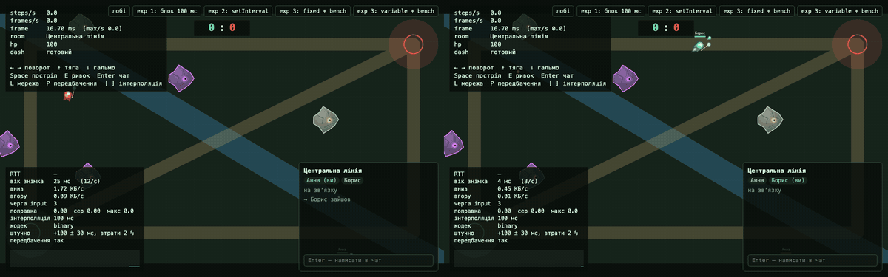
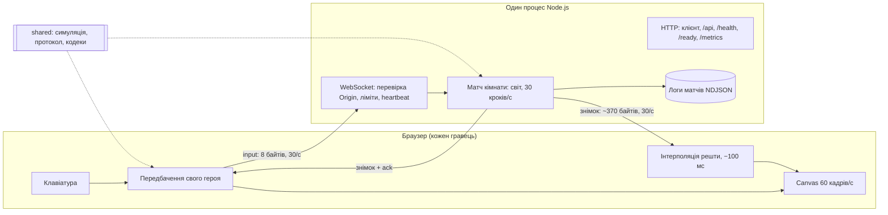
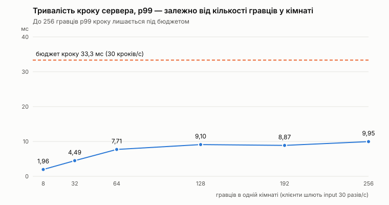

# MOBA Arena

[](https://github.com/nekojidev/moba-arena/actions/workflows/ci.yml)



Мультиплеєрна браузерна гра в реальному часі: герой-маг літає MOBA-ареною (три лінії, річка,
дві бази), стріляє чарівними снарядами, б'ється з іншими гравцями й ботами, розбиває
кам'яних големів і підбирає руни. Клієнт — canvas без фреймворків, сервер — Node.js, спільна
симуляція — один пакет на TypeScript для обох. Семестровий проєкт курсу JavaScript,
зроблений за вісім лабораторних.

## Стан публікації

| Що                                                 | Стан                                                                          |
| -------------------------------------------------- | ----------------------------------------------------------------------------- |
| образ Docker, перевірений `docker stop`            | готово                                                                        |
| пайплайн за тегом `v*`: збірка → GHCR → деплой     | збірка й публікація готові; крок деплою — заглушка                            |
| **жива адреса з `wss://`**                         | **ще немає: хостинг не підключено**                                           |
| тег `v1.0.0`                                       | не поставлено — він запускає публікацію образу й деплой                       |
| двоє гравців з інших мереж, їхній RTT              | не проводилось — потрібна жива адреса                                         |
| встановлення на телефон                            | маніфест і service worker перевірені в Chromium; на справжньому телефоні — ні |
| монітор доступності `/health`, відео на 3–5 хвилин | не зроблено                                                                   |

Як підключити хостинг — у коментарях `.github/workflows/release.yml` (приклад для Fly.io).

## Як грати

| Клавіша | Дія                                                                    |
| ------- | ---------------------------------------------------------------------- |
| ← →     | поворот                                                                |
| ↑       | тяга вздовж напрямку погляду                                           |
| ↓       | гальмо                                                                 |
| Space   | постріл (можна тримати)                                                |
| E       | ривок уперед (перезарядка 2,5 с)                                       |
| Enter   | написати в чат (Esc — повернутись до гри)                              |
| L       | штучна мережа: без затримки → 100 мс → 100 ± 30 / 2 % → 250 ± 50 / 5 % |
| P       | увімкнути / вимкнути передбачення                                      |
| [ ]     | затримка інтерполяції −10 / +10 мс                                     |
| M       | звук                                                                   |

Введіть ім'я, оберіть кімнату — і ви в матчі. Один гравець грає з ботом; `?bots=8` в адресі
додає вісім. Руни: **щит** (5 с невразливості), **швидкий вогонь** (6 с), **самонаведення**
(8 с). Очки: герой — 100, голем — 10 × розмір. Гра розрахована на клавіатуру: на телефоні
вона встановлюється й відкривається, але керувати нічим.

## Запуск

```bash
npm install
npm start          # збирає клієнт і запускає сервер → http://127.0.0.1:3000
```

Або в контейнері, як на хостингу:

```bash
docker compose up --build      # http://localhost:3000
```

Для розробки — два термінали: `npm run dev:server` і `npm run dev:client`
(Vite на `http://localhost:5173`, проксує `/api` і `/ws`).

```bash
npm run typecheck   # tsc --noEmit у кожному пакеті
npm run lint        # ESLint із перевіркою типів
npm test            # 364 тести Vitest: shared 220, клієнт 72, сервер 72
npm run e2e         # Playwright: два браузери в одній кімнаті
```

## Як це влаштовано



- **Сервер — єдине джерело правди.** Клієнт надсилає лише кнопки (`input` із номером),
  координат сервер не приймає. Світ рахується 30 разів/с і розсилається знімками.
- **Свій герой — одразу, решта — трохи в минулому.** Клієнт застосовує input тією самою
  функцією, що й сервер, а з кожним знімком звіряється й заново програє непідтверджені
  input. Інших гравців малює на 100 мс позаду, між двома знімками.
- **Один код в обох середовищах.** Пакет `shared` не знає ні про DOM, ні про Node; симуляція
  детермінована до біта (власні `sin`/`cos`/`atan2`, сіяний генератор випадкових чисел) —
  це перевіряє еталонний хеш у Node і в Chromium.
- **Усі гравці кімнати — в одному процесі.** Стан матчу живе в пам'яті процесу, тому
  кімнату не можна розділити між двома екземплярами сервера без спільного сховища чи
  «липких» сесій. Зараз екземпляр один.

```txt
shared/   симуляція, протокол (схеми Zod), бінарний і JSON-кодеки   — TypeScript, без DOM і Node
client/   Vite, canvas, передбачення, інтерполяція, лобі, чат, PWA
server/   node:http + ws: кімнати, матчі, боти, логи матчів, метрики
e2e/      Playwright
docs/     звіти лабораторних, графіки, скриншоти
```

## Виміряне

**Протокол** (4 гравці, 30 знімків/с, [Lab 5](docs/labs/lab-05.md)):

| Кодек               | Байтів/знімок | КБ/с на клієнта (вниз) | КБ/с (вгору) | Encode+decode, мкс |
| ------------------- | ------------- | ---------------------- | ------------ | ------------------ |
| JSON                | 3163          | 92,66                  | 2,70         | 18                 |
| Binary (`DataView`) | 371           | 10,88                  | 0,23         | 2,7                |

**Передбачення** (штучні +100 мс, [Lab 5](docs/labs/lab-05.md)): медіана поправки 0,00 одиниці,
сплески до 53 — на зіткненнях, яких клієнт не рахує.

**Клієнт, 30 с із вісьмома ботами** ([Lab 7](docs/labs/lab-07.md)):

| Показник                   | До            | Після         |
| -------------------------- | ------------- | ------------- |
| час кадру p50 / p99, мс    | 16,7 / 16,8   | 16,7 / 16,8   |
| `render` p99, мс           | 1,0           | 0,6           |
| створюється об'єктів, КБ/с | 1896          | 775           |
| великі збирання сміття     | 5 (до 6,6 мс) | 3 (до 9,8 мс) |

**Скільки гравців тримає один процес** (одна кімната, input 30 разів/с, [Lab 7](docs/labs/lab-07.md)):



| Гравців | Крок p50 / p99, мс | Цикл подій зайнятий | КБ/с на клієнта |
| ------- | ------------------ | ------------------- | --------------- |
| 8       | 0,92 / 1,96        | 6 %                 | 20,5            |
| 64      | 5,04 / 7,71        | 21 %                | 93,8            |
| 128     | 6,46 / 9,10        | 25 %                | 153,0           |
| 256     | 9,04 / 9,95        | 34 %                | 248,5           |

За процесором межі в 33 мс не знайдено й на 256 гравцях (більше не дозволяє конфіг). Першим
упирається канал: трафік на гравця росте разом із кількістю гравців у кімнаті, бо кожному
їде знімок усієї арени. Типова кімната обмежена вісьмома гравцями.

## Експлуатація ([Lab 8](docs/lab-08))

- **Зупинка.** За `SIGTERM` сервер перестає пускати нових, шле всім повідомлення `shutdown`,
  закриває сокети кодом 1001, дописує логи й виходить із кодом 0. `docker stop` — **0,15 с**,
  код 0, клієнт отримав `shutdown` і 1001, останній рядок логу — `bye`. Клієнт після цього
  сам повертається в лобі з поясненням.
- **`/health`** — процес живий (і версія збірки: git SHA). **`/ready`** — чи можна пускати
  гравців: під час зупинки відповідає 503. **`/metrics`** — формат Prometheus: гравці,
  кімнати, повідомлення й байти за секунду, час кроку p50/p99 по кімнатах, зайнятість циклу
  подій, пам'ять, відмови за причинами.
- **Логи** — рядки JSON через pino з `roomId` і `playerId`; текст чату, заголовки запитів і
  змінні оточення не логуються.
- **Необроблений виняток** пишеться в лог зі стеком і завершує процес із кодом 1.
- **Захист.** Заголовок `Origin` звіряється на рукостисканні WebSocket (чужий — 403);
  ліміт з'єднань з однієї IP (429); ліміти розміру кадру, частоти повідомлень, часу на вхід;
  повільному клієнту некритичне не шлеться.

**Образ** (`node:24-alpine`, чотири етапи): 58,5 МБ стиснутий, 152,6 МБ розпакований; у
ньому лише `ws`, `pino`, `zod` і спільний пакет, без npm; процес від користувача `node`,
`CMD ["node", "server/src/index.ts"]`, `HEALTHCHECK` на `/health`. Колонка DISK USAGE в
`docker image ls` показує 215 МБ — у сховищі containerd це приблизно сума стиснутого й
розпакованого. Подробиці — [docker-report.md](docs/lab-08/docker-report.md).

**Перевірка збоями** ([chaos-report.md](docs/lab-08/chaos-report.md), усе на localhost):

| Збій                                         | Що сталося                                                                                        |
| -------------------------------------------- | ------------------------------------------------------------------------------------------------- |
| клієнт зник без закриття сокета              | прибраний за 5 мс; «завислий» (TCP живий) — за 2,45 с через heartbeat у 1 с                       |
| сервер убито (`SIGKILL`) і піднято через 1 с | клієнти знову в кімнаті через 1,5–2,6 с після вбивства; матч новий                                |
| 1000 битих кадрів/с у кімнату A, 10 с        | порушника закривають на першому кадрі (медіана 0,9 мс); крок кімнати B: p99 1,79 → 0,88 → 0,83 мс |

Під час потоку битих кадрів час кроку сусідньої кімнати не виріс, але зайнятість циклу подій
піднялась із 6 % до 29 %. Кімнати живуть в одному потоці, тож справжньої ізоляції між ними
немає: достатньо сильний потік затримав би всіх.

Головні змінні оточення (повний перелік — `server/.env.example`):

| Змінна                              | Типово          | Навіщо                                                                     |
| ----------------------------------- | --------------- | -------------------------------------------------------------------------- |
| `PORT`, `HOST`                      | 3000, 127.0.0.1 | де слухати; у контейнері `HOST=0.0.0.0`                                    |
| `ALLOWED_ORIGINS`                   | порожньо        | з яких сторінок можна відкривати сокет; **на хостингу задати обов'язково** |
| `TRUST_PROXY`                       | 0               | брати IP гравця з `X-Forwarded-For`; вмикати лише за проксі                |
| `MAX_CONNECTIONS_PER_IP`            | 32              | з'єднань з однієї адреси                                                   |
| `MAX_ROOMS`, `MAX_PLAYERS_PER_ROOM` | 20, 8           | ліміти кімнат і гравців                                                    |
| `LOG_LEVEL`, `LOG_DIR`              | info, ./logs    | рівень логів і каталог логів матчів                                        |
| `GIT_SHA`                           | dev             | версія збірки; її видно в `/health` і в HUD                                |

## Обмеження і чому вони лишились

- **Немає живої адреси.** Хостинг потребує акаунта й токена; пайплайн готовий їх прийняти.
- **Один екземпляр сервера.** Матч живе в пам'яті процесу; після перезапуску матч новий, а
  рахунок зникає. Для кількох екземплярів потрібні «липкі» сесії або спільне сховище.
- **Немає компенсації затримки пострілів.** Сервер перевіряє влучання за поточним станом, а
  гравець цілився в картинку 100+ мс давності — по рухомій цілі треба брати упередження.
- **Швидкий снаряд може проскочити ціль.** Зіткнення перевіряються в кінці кроку; на
  зустрічних курсах пара зближується на 54 одиниці за крок при сумі радіусів 21. Відомо з
  тестів; виправлення змінить еталонний хеш симуляції.
- **Клієнт не передбачає зіткнень** — удар об голема видно як ривок-поправку.
- **Трафік росте з кількістю гравців у кімнаті:** кожному їде знімок усієї арени, без
  відсікання далеких сутностей і без передачі лише змін.
- **Великі збирання сміття на клієнті не зникли зовсім** (3 за 30 с, до 9,8 мс): записи
  знімків створюються заново 30 разів/с.
- **Немає бану за зловживання:** порушника від'єднують, але він може одразу підключитись
  знову — стримує лише ліміт з'єднань з IP.
- **`TRUST_PROXY` довіряє першій адресі в `X-Forwarded-For`** — це безпечно лише за проксі,
  який цей заголовок перезаписує.
- **На телефоні не пограти:** керування лише з клавіатури.
- **Немає акаунтів і підбору суперників:** ім'я — будь-яке, кімнату обирають вручну.

## Що я зробив би далі

1. Підключити хостинг, поставити `v1.0.0`, запросити двох людей з інших мереж і записати їхній RTT.
2. Знімки лише зі змінами й лише про сусідів — прибере головне обмеження місткості.
3. Компенсація затримки пострілів і перевірка влучання за відрізком, а не точкою.
4. Сенсорне керування, щоб встановлена на телефон гра була грабельною.
5. Декодування знімків у готові об'єкти з пулу — до нуля великих збирань сміття.
6. Кілька екземплярів сервера: «липкі» сесії за кімнатою або Redis для списку кімнат.
7. Підбір суперників, акаунти, збережений рахунок.

## Історія: вісім лабораторних

| Тег      | Тема                                                                    | Звіт                             |
| -------- | ----------------------------------------------------------------------- | -------------------------------- |
| `lab-01` | event loop, фіксований крок симуляції, рендер з інтерполяцією           | [lab-01.md](docs/labs/lab-01.md) |
| `lab-02` | класи, `this`, `Map`, колізії, композиція замість спадкування           | [lab-02.md](docs/labs/lab-02.md) |
| `lab-03` | проміси, завантаження ассетів, лобі, звук, шина подій                   | [lab-03.md](docs/labs/lab-03.md) |
| `lab-04` | сервер на Node: кімнати, WebSocket, чат, потоки й backpressure          | [lab-04.md](docs/labs/lab-04.md) |
| `lab-05` | сервер рахує гру: передбачення, звірка, інтерполяція, бінарний протокол | [lab-05.md](docs/labs/lab-05.md) |
| `lab-06` | TypeScript під `strict`, схеми Zod, branded-типи                        | [lab-06.md](docs/labs/lab-06.md) |
| `lab-07` | Vitest, fast-check, Playwright, CI, профілювання, пули, навантаження    | [lab-07.md](docs/labs/lab-07.md) |
| `lab-08` | зупинка за SIGTERM, метрики, Origin, Docker, пайплайн за тегом, PWA     | [docs/lab-08](docs/lab-08)       |

Специфікація бінарного формату — [shared/PROTOCOL.md](shared/PROTOCOL.md). Усі ассети
зроблені в цьому ж репозиторії: спрайти — SVG зі скрипта, звуки синтезовані.

У звіті [lab-01](docs/labs/lab-01.md) таблиці браузерних замірів трьох експериментів досі не
заповнені.
