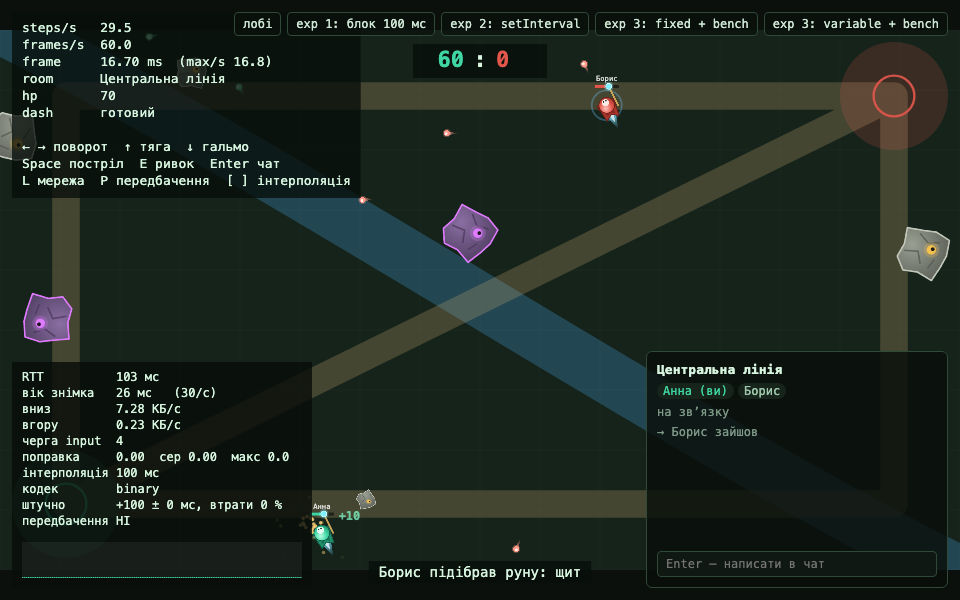
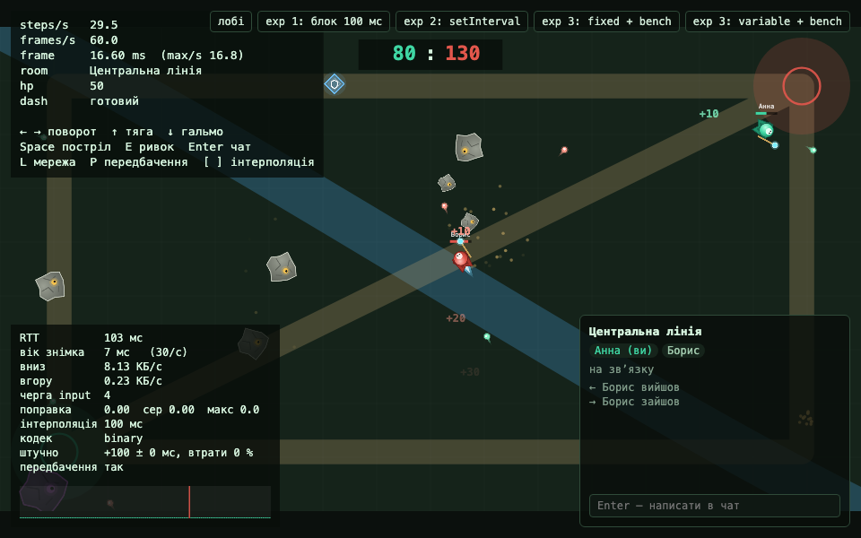
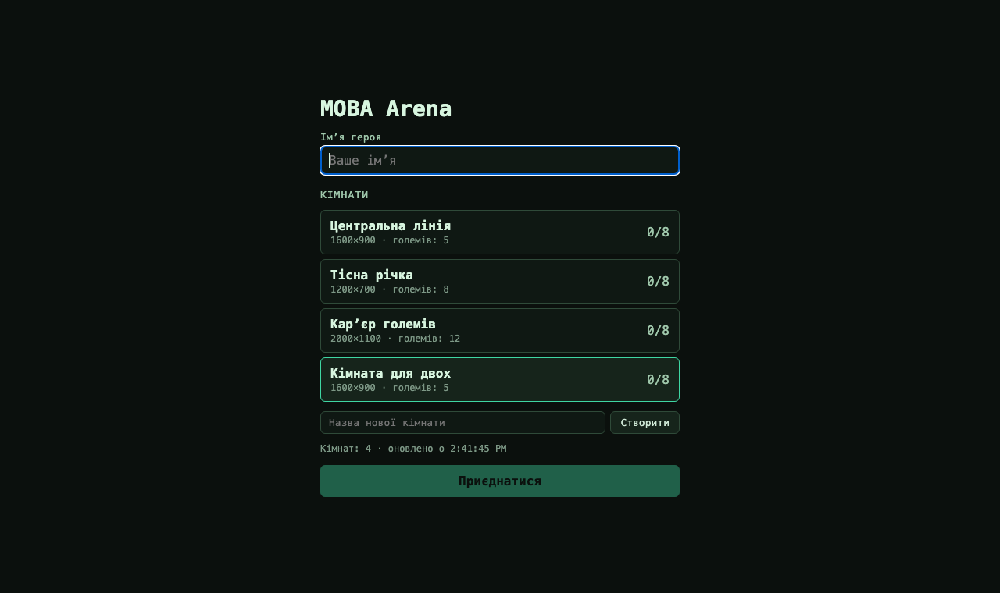
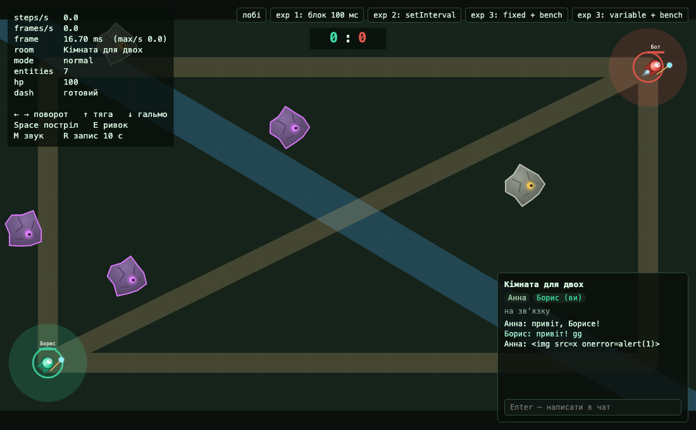
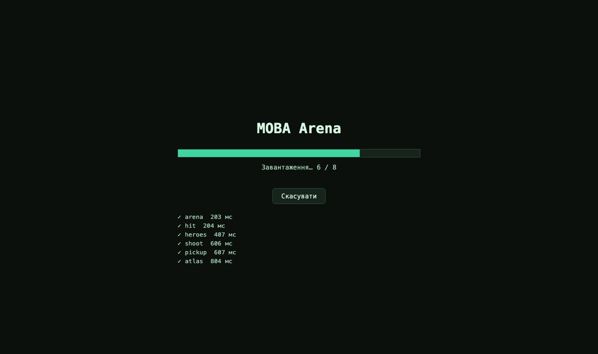
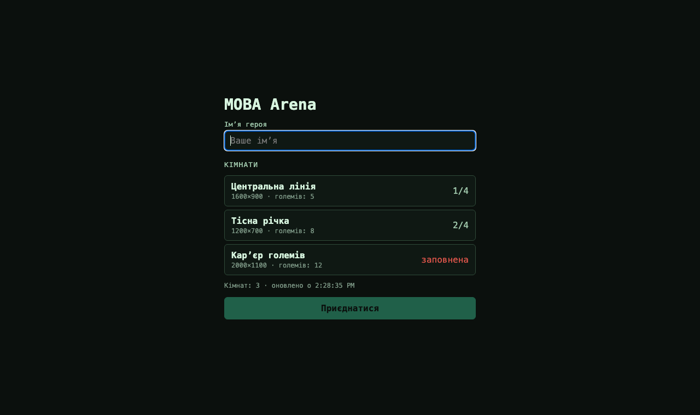
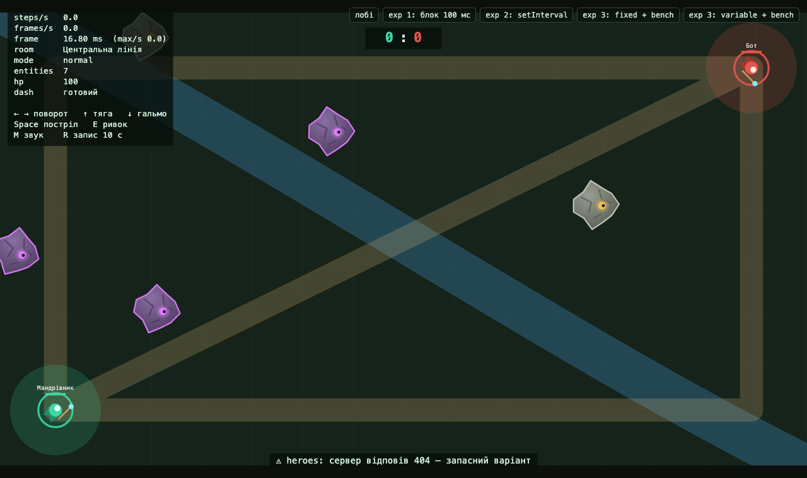
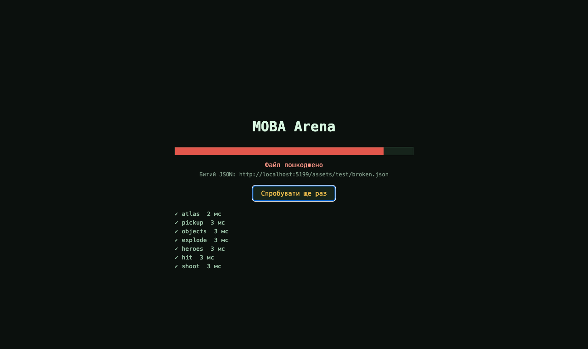
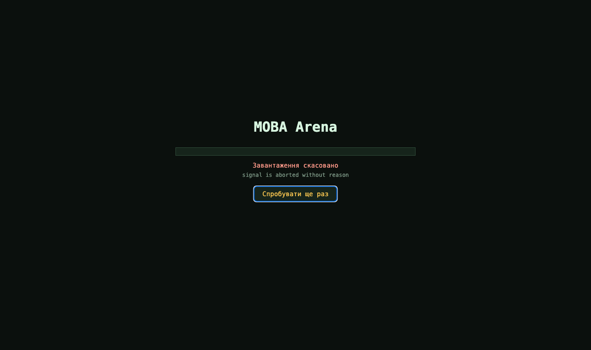

# MOBA Arena


_Два вікна — один матч на сервері. Штучна мережа: +100 ± 30 мс, втрати 2 %. Ліворуч унизу —
netgraph._

Мультиплеєрна браузерна гра, яку будуємо лаба за лабою (курс JavaScript). Герой-маг літає
MOBA-ареною (три лінії, річка, дві бази), стріляє чарівними снарядами, б'ється з іншими
гравцями, розбиває кам'яних големів і підбирає руни.

- **Lab 1** (тег `lab-01`) — event loop, фіксований крок симуляції, рендер з інтерполяцією.
- **Lab 2** (тег `lab-02`) — модель сутностей: класи, `this`, `Map`, колізії, композиція.
- **Lab 3** (тег `lab-03`) — асинхронність: завантаження ассетів, лобі, звук, шина подій.
- **Lab 4** (тег `lab-04`) — сервер на Node: кімнати, WebSocket, чат, логи матчів потоками.
- **Lab 5** (тег `lab-05`) — сервер рахує гру: передбачення, звірка, інтерполяція, бінарний
  протокол.
- **Lab 6** (тег `lab-06`) — усе на TypeScript під `strict`: схеми Zod, branded-типи,
  вичерпні `switch`.

## Запуск

```bash
npm install                 # один раз, у корені: ставить shared/, client/ і server/

# розробка — два термінали
npm run dev:server          # сервер гри на http://127.0.0.1:3000 (перезапуск при змінах)
npm run dev:client          # Vite на http://localhost:5173, проксує /api і /ws на сервер

# «продакшен»: сервер сам віддає зібраний клієнт
npm start                   # збирає client/dist і запускає сервер → http://127.0.0.1:3000

npm run typecheck           # tsc --noEmit у кожному пакеті (те саме робить CI)
npm test                    # 90 тестів: shared (26), клієнт (31), сервер (33)
npm run lint                # ESLint
npm run format              # Prettier
```

Для двох гравців відкрийте два вікна й зайдіть в одну кімнату. Один гравець грає з ботом.

Налаштування сервера — змінні оточення (`server/.env.example` → `server/.env`):
`PORT`, `HOST`, `LOG_DIR`, `CLIENT_DIST`, `DEBUG_ROUTES` та ліміти.

Мережеві параметри клієнта — в адресному рядку, наприклад
`http://localhost:5173/?lag=100&jitter=30&drop=2`:

| Параметр       | Що робить                                                   |
| -------------- | ----------------------------------------------------------- |
| `lag=100`      | додає 100 мс затримки «туди й назад» (по 50 мс у кожен бік) |
| `jitter=30`    | розкид цієї затримки, ± мс                                  |
| `drop=2`       | відсоток втрачених ігрових повідомлень                      |
| `predict=0`    | вимкнути передбачення: герой рухається лише за знімками     |
| `interp=100`   | затримка інтерполяції, мс                                   |
| `codec=json`   | JSON замість бінарного формату                              |
| `chaos=random` | дослід: `Math.random()` у кроці передбачення                |

Досліди й утиліти:

```bash
npm run bench:codec -w server    # Lab 5: JSON проти бінарного кодека, 4 гравці
npm run bench:rss -w server      # Lab 4: графік rss під час повільного завантаження логу
npm run demo:block -w server     # Lab 4: чат, поки обробник на 300 мс займає цикл подій
npm run demo:error -w server     # Lab 4: 'error' без слухача валить процес; фікс
npm run replay -w server -- <файл.ndjson>   # підсумок логу матчу
npm run puzzles -w client        # Lab 3: головоломки порядку виконання
npm run this-bug -w client       # Lab 2: баг із this і три фікси
npm run determinism -w client    # Lab 1: експеримент 3 без браузера
```

| Клавіша | Дія                                                             |
| ------- | --------------------------------------------------------------- |
| ← →     | поворот                                                         |
| ↑       | тяга вздовж напрямку погляду                                    |
| ↓       | гальмо                                                          |
| Space   | постріл (можна тримати)                                         |
| E       | ривок уперед (перезарядка 2.5 с)                                |
| Enter   | написати в чат (Esc — повернутись до гри)                       |
| L       | мережа: без затримки → 100 мс → 100 ± 30 / 2 % → 250 ± 50 / 5 % |
| P       | увімкнути / вимкнути передбачення                               |
| [ ]     | затримка інтерполяції −10 / +10 мс                              |
| M       | вимкнути / увімкнути звук                                       |

Руни: **щит** (блакитна, 5 с невразливості), **швидкий вогонь** (помаранчева, 6 с),
**самонаведення** (фіолетова, 8 с — снаряди самі повертають до цілі). Фіолетові големи теж
самонавідні: повільно повзуть до найближчого героя. Очки: герой — 100, голем — 10 × розмір.

Усі ассети зроблені в цьому ж репозиторії: спрайти — SVG з `client/scripts/make-sprites.js`
(`client/art/*.svg`, експортовані в PNG), звуки синтезує `client/scripts/make-sounds.js`.

## Структура

```txt
package.json         # "workspaces": ["shared", "client", "server"]
tsconfig.base.json   # strict, noUncheckedIndexedAccess, verbatimModuleSyntax, erasableSyntaxOnly
.github/workflows/ci.yml   # npm ci → typecheck → lint → test
shared/              # код, однаковий у браузері і в Node: без DOM і без модулів Node
  PROTOCOL.md        # специфікація бінарного формату
  src/
    brand.ts         # branded-типи EntityId, Tick, Seq
    bus.ts           # типізована шина подій Bus<Events>
    protocol.ts      # схеми Zod усіх повідомлень, виведені типи, parseClientMessage
    codec/           # index.ts (interface Codec), binary.ts (DataView), json.ts
    sim/             # симуляція: world.ts, ship.ts, combat.ts, dmath.ts, events.ts, …
  test/
client/              # застосунок на Vite
  index.html  puzzles.html  selftest.html  vite.config.js
  src/
    main.ts          # завантаження → лобі → гра
    netplay.ts       # мережева гра: input → сервер, передбачення, інтерполяція
    play.ts          # локальна гра без сервера (режими Lab 1: ?exp, ?bench)
    guards.ts        # assertNever, isRecord, requireElement
    net/             # connection.ts, prediction.ts, interpolation.ts, injector.ts, netgraph.ts
    chat.ts  effects.ts  hud.ts  audio.ts  loop.ts  input.ts  async.ts  puzzles.ts
    assets/  lobby/  screens/  render/
  scripts/  test/  art/
server/
  src/
    index.ts  app.ts  api.ts  static.ts  logger.ts
    config.ts        # оточення → схема Zod → ServerConfig
    emitter.ts       # TypedEmitter: EventEmitter із перевіркою імен і даних подій
    match.ts         # Match: світ, 30 кроків/с із точним таймером, черги input, знімки
    rooms.ts         # Room і RoomManager з типізованими подіями
    ws.ts            # життєвий цикл сокета: join, heartbeat, ліміти, повільні клієнти
    log/             # matchlog.ts (Transform → NDJSON), replay.ts
  scripts/  test/
docs/                # GIF, скриншоти й графіки для README
```

Код у `src/` — TypeScript; тести й допоміжні скрипти лишились на JavaScript і імпортують
`.ts` напряму. Кроку збірки для сервера немає: Node сам стирає типи під час запуску.
У розділах Lab 1–5 нижче файли названо з розширенням `.js` — так вони називались на
відповідних тегах.

# Lab 6 — TypeScript для протоколу і симуляції

Три пакети переведено на TypeScript під `strict` і `noUncheckedIndexedAccess`. Поведінка
не змінилась: еталонний матч дає той самий хеш `4182399d` у Node і в Chromium, а сценарій
двох вікон із Lab 5 дає ті самі показники netgraph.

| Що                               | Стан                                                  |
| -------------------------------- | ----------------------------------------------------- |
| `npm run typecheck`              | 0 помилок у `shared`, `client`, `server`; стоїть у CI |
| файлів `.ts` у `src/`            | 65, файлів `.js` — 0                                  |
| `any`, `@ts-ignore`, `!`         | 0 (заборонені ще й правилами ESLint)                  |
| приведень `as` (крім `as const`) | 1 на весь код                                         |
| тести                            | 90 із 90                                              |

## Як улаштовано

- **`tsconfig.base.json`** — спільні суворі налаштування; у кожного пакета свій `tsconfig.json`.
  `shared` збирається з `"lib": ["ES2023"]` і `"types": []`: звернення до `window` чи
  `process` у спільному коді — тепер помилка компіляції, а не лише тест.
- **Без кроку збірки.** Vite і Node лише стирають типи й нічого не перевіряють — перевіряє
  `tsc --noEmit` (локально й у CI). `erasableSyntaxOnly` забороняє синтаксис, який не можна
  просто стерти (`enum`, параметри-властивості конструктора).
- **`shared/src/protocol.ts` — єдине джерело правди.** Кожне JSON-повідомлення в обидва боки
  описане схемою Zod, тип виводиться зі схеми через `z.infer`. Ручну перевірку з Lab 4
  (`server/src/protocol.js`) видалено.
- **`parseClientMessage(data: unknown)`** ніколи не кидає виняток: повертає
  `{ ok: true, message }` або `{ ok: false, code, reason }`. Битий JSON — запис у лог і
  закриття сокета з кодом, як у Lab 4. Клієнт так само розбирає все, що приходить від
  сервера (`parseServerMessage`), і список кімнат із HTTP.
- **Бінарний декодер** сам перевіряє байт версії, тип, довжину і діапазони (hp ≤ 100,
  розмір голема 1…3, індекс ефекту, скінченність `f32`) — і лише тоді збирає значення.
- **`interface Codec`** із двома реалізаціями, бінарною і JSON; решта коду працює з `Input`
  і `Snapshot` і не знає, байти це чи текст.
- **Вичерпні `switch`.** Кожен розбір за `type` або `kind` закінчується `default`, який
  передає значення у параметр типу `never` (`assertNever` / `unreachable`).
- **Сервер:** події кімнати типізовані (`TypedEmitter<RoomEvents>`), конфіг з оточення
  проходить через схему Zod (`ServerConfig`), у кожному `catch` помилка — `unknown` і
  звужується через `instanceof`.

## Баг, який ловлять типи: показати на захисті

Додаємо у протокол новий вид сутності — «міну» — і більше нічого не чіпаємо:

```ts
export const KINDS = ['ship', 'bullet', 'asteroid', 'pickup', 'mine'] as const;
// …і ще один варіант у entitySchema: { kind: 'mine', …, armed: boolean }
```

`npm run typecheck` одразу показує всі місця, де про міну забули:

```txt
shared/src/codec/binary.ts: Property 'mine' is missing in type '{ ship: number; bullet: number;
                            asteroid: number; pickup: number; }' but required in type 'Record<…>'
shared/src/codec/binary.ts: Argument of type 'Readonly<{ armed: boolean; …; kind: "mine"; }>'
                            is not assignable to parameter of type 'never'.      ← кодування
shared/src/codec/binary.ts: Argument of type '"mine"' is not assignable to parameter of type
                            'never'.                                             ← декодування
client/src/netplay.ts:      Argument of type 'Readonly<{ …; kind: "mine"; }>' is not assignable
                            to parameter of type 'never'.                        ← малювання
```

У JavaScript міна просто не кодувалась би й не малювалась — мовчки. (Я справді вніс цю зміну,
зняв вивід і відкотив.)

## Що знайшов TypeScript

Справжні проблеми, які були в JavaScript-коді й вилізли під час переведення:

1. **Подія з неповними даними.** Клієнт на власний постріл розсилав `fired` лише з
   `{ shipId }`, хоча подія містить ще `team` і `homing`. Слухач звуку їх не читав, тому
   ніхто не помічав. Знайшла типізована шина (`netplay`).
2. **`undefined` як ключ `Map`.** `shipId` у складі кімнати необов'язковий, а клієнт робив
   `names.set(player.shipId, …)` без перевірки (`netplay`).
3. **Наполовину підключений гравець.** У матчі `codec` і `send` були двома окремо
   необов'язковими полями; розсилка перевіряла лише `send`, а викликала `codec`. Тепер це
   одне поле `link` (`match`).
4. **`welcome` без `shipId`.** Якщо матчу для кімнати немає, поле стало б `undefined`,
   мовчки зникло б із JSON, і клієнт відкинув би таке повідомлення. Тепер сокет закривається з кодом
   (`ws`).
5. **Перевірили не те поле.** Код читав `state.player.id`, перевіривши лише `state.room` —
   обидва можуть бути `null` (`ws`, три місця).
6. **`Map.get(…)` без перевірки:** `socketsByRoom.get(room.id).add(ws)` (`ws`).
7. **Поле, якого не існувало.** Самонаведення читало `entity.ownerId` у будь-якої сутності,
   а поле було лише в снаряда; для голема порівняння з `undefined` «працювало» випадково.
   Тепер `ownerId` оголошено в `Entity`.
8. **Таблиця обробників за рядком.** Зіткнення шукали обробник за ключем
   `` `${a.kind}:${b.kind}` `` — одруківка в ключі означала б, що пара мовчки не обробляється.
   Замінено вичерпним `switch` (`combat`); так само таблиці малювання в клієнті.
9. **Індекс ефекту з мережі не перевірявся.** Бінарний декодер брав `EFFECTS[байт]` як є:
   з чужого байта виходила руна з ефектом `undefined`. Показав `noUncheckedIndexedAccess`.
10. **JSON-знімок не перевірявся взагалі** — клієнт вірив будь-якому об'єкту з полем `type`.
    Тепер кожен текстовий кадр проходить схему.
11. **Арифметика з `null`.** Годинник сервера до першого знімка рахував `clientNow - null` і
    спирався на те, що `null` стане нулем (`interpolation`).
12. **Поля, що є не завжди.** Чат читав `waitMs` і `reason` у будь-якого статусу з'єднання, а
    вони є лише в `waiting` і `closed`. Статус став розрізнюваним об'єднанням (`chat`).
13. **`server.address()` і `request.url`** можуть бути `null` / `undefined` — код читав їх
    без перевірки (`app`, `api`, `static`).
14. **`catch` вважав, що зловив `Error`:** `error.message`, `error.code`, `error.stack` без
    перевірки — у клієнті й на сервері.
15. **Версія протоколу числом у коді.** Кадр подій збирався як `{ v: 1, … }` повз спільну
    функцію; при зміні версії він би розійшовся з рештою (`match`).
16. **Неоголошена подія.** `shutdown` кімнати розсилалась, але в переліку подій її не було —
    карта подій змусила її оголосити (`rooms`).

Не все з цього «помилки типів» у вузькому сенсі: пункти 2, 5, 6, 9, 11 і 13 — це пропущені
перевірки на `undefined`, які `strict` і `noUncheckedIndexedAccess` роблять обов'язковими.

## Три типи простими словами

**1. Branded-тип — число з етикеткою.**

```ts
declare const brandTag: unique symbol;
type Brand<T, Name extends string> = T & { readonly [brandTag]: Name };
type EntityId = Brand<number, 'EntityId'>;
type Seq = Brand<number, 'Seq'>;
```

Для JavaScript id сутності й номер input — просто числа, і їх легко переплутати місцями:
`world.get(seq)` виконається й тихо поверне не те. `Brand` дописує до типу `number` уявне
поле-етикетку. У рантаймі його немає — це те саме число, — але `tsc` тепер вважає `EntityId`
і `Seq` різними типами й не дає передати одне замість іншого. Звичайне число стає
брендованим в одному місці (`brand()`), і з мережі воно приходить уже з етикеткою: схема
Zod перевіряє, що це ціле в межах `u32`, і одразу його «підписує».

**2. Шина, де ім'я події визначає її дані.**

```ts
interface GameEvents {
  fired: { shipId: EntityId; team: Team; homing: boolean };
  score: { id: EntityId; points: number; total: number };
  // …
}

class Bus<Events extends object> {
  on<K extends keyof Events>(type: K, handler: (payload: Events[K]) => void): () => void;
  emit<K extends keyof Events>(type: K, payload: Events[K]): void;
}
```

`GameEvents` — звичайний «словник»: ім'я події → форма даних. `K extends keyof Events`
читається як «`K` — одне з імен зі словника», а `Events[K]` — «те, що в словнику під цим
іменем». Тому в `bus.on('score', (p) => …)` тип `p` виводиться з рядка `'score'`, а
`bus.on('scroe', …)` чи `emit('fired', { shipId })` без решти полів не компілюються. З
`EventTarget` ім'я було просто рядком, а дані — `detail` невідомої форми.

**3. Події для мережі, виведені з подій симуляції.**

```ts
type ForwardedEvent = 'fired' | 'hit' | 'exploded' | 'pickup' | 'respawned';
type NetEvent = {
  [K in ForwardedEvent]: { readonly type: K } & GameEvents[K];
}[ForwardedEvent];
```

Сервер пересилає клієнтам частину подій світу, дописуючи до кожної поле `type`. Замість
того щоб описувати п'ять форм удруге, тип будується з `GameEvents`: «для кожного імені `K`
зі списку візьми форму `GameEvents[K]` і додай `type: K`», а `[ForwardedEvent]` наприкінці
збирає п'ять результатів в одне об'єднання. Вийшло розрізнюване об'єднання: у
`switch (event.type)` усередині `case 'exploded'` `tsc` знає, що є `x`, `y` і `size`. Схема
Zod для цих подій оголошена як `z.ZodType<NetEvent>`, тож якщо змінити подію в симуляції й
забути про схему — це помилка компіляції.

## Єдине приведення `as`

```ts
export function brand<B extends Brand<number, string>>(value: number): B {
  // as: бренд існує лише в типах — «виготовити» його інакше, ніж приведенням, неможливо.
  return value as B;
}
```

Усе інше зроблено звуженням: `instanceof`, перевірки на `null`, функції-охоронці
(`value is …`), `querySelector<HTMLCanvasElement>` з явною перевіркою результату.

## Фреймворк: не брав

Лобі й панель чату лишились на DOM без React, Vue чи Svelte.

- **Мало стану.** Два невеликі екрани: список кімнат із полем імені та чат зі складом
  гравців — разом кількасот рядків. Оновлюються вони рідко (раз на 3 с і на повідомлення).
- **Головну вигоду вже дали типи.** Те, заради чого зазвичай беруть фреймворк із TypeScript,
  — перевірений потік даних від мережі до інтерфейсу — тут уже є: `parseServerMessage` на
  вході й типізовані підписки `connection.on('roster', …)`, `lobby.on('rooms', …)`.
- **Ціна.** Ще одна залежність, плагін збірки і другий спосіб писати інтерфейс поруч із
  canvas, який фреймворку все одно не дістається. Збірка клієнта і так виросла з 49 до
  146 КБ (з 19 до 47 КБ у gzip) — майже все це Zod.
- **Коли варто передумати.** Якщо з'являться екрани з багатим станом: таблиця результатів,
  налаштування, історія матчів, профіль.

## Що змінилось у числах

Перевірка в JSON-кодеку тепер іде через Zod, тому він став повільнішим; розміри ті самі.
Повтор заміру з Lab 5 (4 гравці, 30 знімків/с):

| Кодек               | Байтів/знімок | Encode+decode, мкс |
| ------------------- | ------------- | ------------------ |
| JSON + Zod          | 3163          | 18                 |
| Binary (`DataView`) | 371           | 2.7                |

# Lab 5 — сервер рахує гру

Клієнт надсилає **input** (газ, поворот, постріл), а не координати. Світ рахує лише сервер
і 30 разів на секунду розсилає знімки стану.

## Як це влаштовано

- **`shared/`.** Симуляція переїхала в окремий пакет: той самий код імпортують клієнт і
  сервер. Тести перевіряють, що пакет імпортує лише власні файли, не згадує `window`,
  `document`, `process` чи `Buffer` і цілком завантажується в Node.
- **Крок із фіксованим `dt = 1/30` с** — і на сервері, і в передбаченні на клієнті.
  Випадковість — лише із сіяного генератора, seed якого задає сервер; `Math.random()`,
  `Date.now()` і `performance.now()` у симуляції заборонені тестом.
- **Сервер** (`match.js`): `Match` на кімнату. Таймер не `setInterval`: кожен крок має
  абсолютний цільовий час `start + N · 33.3 мс`, і наступний `setTimeout` ставиться на
  залишок до нього — запізнення не накопичуються. За хвилину гри двох вікон: крок рахується
  в середньому 0.22 мс, запізнення старту кроку — у середньому 0.65 мс, найбільше 1.97 мс,
  пропущених кроків 0 (`GET /api/stats`).
- **Input.** У кожного є `seq`. Сервер складає їх у чергу гравця й за крок обробляє стільки,
  скільки прийшло; у знімку повертає `ack` — номер останнього обробленого. Герой рухається
  **лише від input**: немає input за цей крок — герой стоїть. Тому його позиція — функція
  отриманих команд, і клієнт може відтворити її точно.
- **Передбачення і звірка** (`net/prediction.js`). Клієнт одразу застосовує input тією самою
  функцією `stepInput` і пам'ятає його, доки сервер не підтвердить. На кожен знімок: викинути
  підтверджені input → стати у стан сервера → заново програти решту. Різниця з тим, що вже
  намальовано, — це «поправка»; вона згладжується експонентою (через 100 мс лишається ≈ 5 %).
- **Інтерполяція** (`net/interpolation.js`). Усіх, крім себе, клієнт малює на 100 мс у
  минулому — між двома знімками з буфера. Сутність, що зникла, домальовується до наступного
  знімка; нова з'являється, коли її знімок стає «лівим»; стрибок понад 300 одиниць (респаун)
  не розмазується. Якщо буфер спорожнів, тримається останній знімок — без екстраполяції.
- **Свої снаряди** з'являються одразу з передбаченого стану. Коли сервер підтверджує постріл,
  його снаряд прив'язується до локального за `id`; коли снаряд на сервері зникає (влучив або
  згас), зникає й локальний. Самонавідні снаряди не передбачаються.
- **Netgraph** (ліворуч унизу): RTT, вік останнього знімка, КБ/с вниз і вгору, черга
  непідтверджених input, величина поправки (остання, середня й найбільша за секунду) і графік
  поправок по знімках.

## Що показав netgraph: до і після передбачення

Два вікна Chromium, штучні +100 мс; обидва гравці 6–8 с летять, повертають і стріляють.

| Режим                          | RTT    | Черга input | Поправка: медіана | середня | найбільша |
| ------------------------------ | ------ | ----------- | ----------------- | ------- | --------- |
| без передбачення (`predict=0`) | 103 мс | 4           | —                 | —       | —         |
| з передбаченням                | 103 мс | 4           | 0.00              | 0.35    | 53.0      |
| `chaos=random`                 | 102 мс | 4           | 1.58              | 2.22    | 51.9      |
| 100 ± 30 мс, втрати 2 %        | 86 мс  | 4           | 0.00              | 3.34    | 414       |

- **Без передбачення** герой реагує на клавішу лише тоді, коли знімок із наслідком пройде
  весь шлях: RTT плюс затримка інтерполяції — понад 200 мс. Керувати можна, але герой
  «на гумці».
- **З передбаченням** герой реагує в тому ж кроці. Медіана поправки — нуль: у чистому полі
  клієнт і сервер рахують однаково. Сплески (до 53 одиниць) — зіткнення з големом чи іншим
  героєм: їх клієнт не передбачає, про відскок він дізнається зі знімка.
- **Погана мережа.** Медіана все одно нуль; середню псують втрачені input (сервер їх не
  бачив — клієнт уже застосував) і респаун: 414 — це телепорт після загибелі, він показується
  стрибком, без згладжування.

| Без передбачення                                         | З передбаченням                                    |
| -------------------------------------------------------- | -------------------------------------------------- |
|  |  |

## Дослід: зламати детермінізм навмисно

`?chaos=random` підмішує `Math.random()` у результат кожного кроку передбачення (у клієнті,
спільний код не чіпається). Поправка перестає бути нулем на **кожному** знімку: медіана
1.58 одиниці замість 0.00, і графік унизу netgraph заповнюється суцільно.


## Баг детермінізму, на який я справді натрапив

Сторінка `selftest.html` проганяє в браузері той самий еталонний матч (600 кроків), що й тест
у Node, і порівнює хеш стану світу. Перший запуск: **Node — `1d6cd7be`, Chromium —
`6d7512e4`**. Симуляція без `Math.random()` і без годинника давала різний результат у двох
рушіях.

Причина: `Math.sin`, `Math.cos`, `Math.atan2` (і `Math.exp`). Стандарт вимагає від них лише
«наближення», і Node з Chrome — різні версії V8 — розходяться в останньому біті. Я порівняв
результати 200 000 викликів кожної функції в обох рушіях: `sin`, `cos`, `atan2`, `exp` —
різні; `sqrt`, `%`, `**`, `Math.round`, `Math.imul`, `Math.hypot` — однакові. Один біт у куті
за кілька секунд стає іншим рішенням бота, іншим зіткненням і зовсім іншим матчем.

Фікс — `shared/src/sim/dmath.js`: власні `sin`, `cos`, `atan2`, зібрані лише з `+ − × ÷` і
`Math.sqrt`, які IEEE 754 визначає біт у біт. Точність проти `Math.*` — 3·10⁻¹³, для гри
з запасом. Після заміни хеш у Node і в Chromium однаковий — `4182399d`. Тест тепер
забороняє `Math.sin/cos/atan2/hypot/exp/random` у `shared/src/sim`.

(У грі цей баг майже не було видно: стан власного героя їде у знімку як `f32`, і різниця
в останньому біті `f64` губилася в округленні. Виявив його саме хеш.)

## Бінарний протокол

Формат описано в [`shared/PROTOCOL.md`](shared/PROTOCOL.md): little-endian, перший байт —
версія, кут — `Int16` (крок ≈ 0.0055°), позиції чужих сутностей — `Uint16` з кроком 1/16
одиниці, власний герой — `Float32`. `input` — рівно 8 байтів. JSON лишився за прапорцем
`?codec=json`. Round-trip тести: `decode(encode(msg))` дорівнює `msg` у межах квантування.

Матч із 4 гравцями, 30 знімків/с, хвилина гри, у середньому 22 сутності у знімку
(`npm run bench:codec -w server`, Node 26, Apple Silicon):

| Кодек               | Байтів/знімок | КБ/с на клієнта (вниз) | КБ/с на клієнта (вгору) | Encode+decode, мкс |
| ------------------- | ------------- | ---------------------- | ----------------------- | ------------------ |
| JSON                | 3163          | 92.66                  | 2.70                    | 9.2                |
| Binary (`DataView`) | 371           | 10.88                  | 0.23                    | 1.8                |

Бінарний знімок у 8.5 раза менший і кодується вп'ятеро швидше. У живій грі двох вікон
netgraph показав те саме співвідношення: 7.2 КБ/с проти 61.6 КБ/с вниз і 0.23 проти 2.67 КБ/с
вгору.

## Запис про мережу

**Затримка.** Між натисканням клавіші й відповіддю сервера минає RTT, і чесно прибрати його
неможливо. Тому клієнт не чекає: свого героя він рухає одразу (передбачення), а коли приходить
знімок — звіряє. Чужих героїв передбачити нема з чого, тож їх він показує на 100 мс пізніше,
зате плавно. Ціна: гравець бачить себе «зараз», а інших — «RTT/2 + 100 мс тому».

**Розбіжність стану.** Передбачення працює лише тому, що клієнт і сервер рахують однаково.
Три речі це тримають: спільний код у `shared/`, фіксований `dt` і герой, який рухається
тільки від input (а не від часу сервера). Розбіжності, що лишаються, — чесні: зіткнення,
яких клієнт не рахує, втрачений input, і знайдений вище баг із `Math.sin`. Кожну видно на
netgraph як сплеск поправки, і звірка сама повертає героя на місце.

**Чіти.** Сервер не приймає від клієнта нічого, крім кнопок: `turn` ∈ {−1, 0, 1} і чотири
біти. Написати «я в точці X» нема куди. Бюджет input — у середньому один на крок із запасом
шість, тож надіславши 300 input/с герой не полетить швидше (перевірено тестом: за 60 кроків
оброблено не більше 66). Номери `seq` мають зростати; кадр не тієї довжини чи з зайвими
бітами закриває сокет із кодом 4000. Чого сервер **не** ловить: бота, який цілиться сам, і
клієнта, що малює більше, ніж належить, — знімок містить усю арену.

**Затримка інтерполяції: 100 мс.** Знімки йдуть кожні 33 мс. Щоб інтерполювати, потрібен
знімок «після» моменту, який малюємо. 100 мс — це три інтервали: один знімок може загубитися,
ще один — запізнитись на 30 мс, і буфер усе одно не спорожніє. При 66 мс один втрачений
знімок уже дає завмирання; при 150–200 мс противника видно надто пізно, і влучити в нього
важче. Значення змінюється на льоту клавішами `[` і `]`, а netgraph пише «буфер порожній!»,
коли затримки не вистачило.

**Чого тут немає.** Компенсації затримки для пострілів: сервер перевіряє влучання за
поточним станом, а стрілець цілився в картинку 100+ мс давності, тож по рухомій цілі треба
брати упередження. І якщо input із пострілом загубився, локальний снаряд долітає «привидом»
без влучання — сервер такого пострілу не бачив.

# Lab 4 — Node.js: EventEmitter, streams, WebSocket-сервер

> Стан на тег `lab-04`: сервер тримав кімнати, вхід, вихід і чат, а кожне вікно грало свій
> локальний матч. З Lab 5 світ рахує сервер — див. вище.

| Лобі зі створеною кімнатою      | Друге вікно                           |
| ------------------------------- | ------------------------------------- |
|  |  |

## HTTP на `node:http`

- **Статика.** Сервер віддає `client/dist` потоком (`pipeline(createReadStream, response)`)
  з MIME-типом за розширенням. Шлях береться «сирим» із `request.url`: будь-який сегмент
  `..` — навіть закодований `%2e%2e` — це `400`, і окремо перевіряється, що шлях після
  `resolve()` лишився всередині каталогу.
- **API.** `GET /api/rooms` — список; `POST /api/rooms` — створення (тіло читається шматками
  з лічильником байтів: понад ліміт — `413`, не JSON чи не та форма — `400`, забагато кімнат —
  `409`); `GET /health` — стан і `rss`; `GET /api/replays` і `GET /api/replays/:id` — логи.
- **Розробка.** Vite проксує `/api`, `/health` і `/ws` на сервер, тож у браузері все на
  одному origin, як і в продакшені.
- **Конфіг.** `config.js` читає `process.env` один раз на старті й перевіряє всі значення
  одразу: `PORT=abc` — це код завершення 1 і список проблем, а не падіння о третій ночі.
- **Штатна зупинка.** За `SIGINT`/`SIGTERM`: перестати приймати з'єднання → закрити сокети
  з кодом `1001` → дописати логи матчів → дочекатися закриття HTTP-сервера. Наприкінці
  `process.exitCode = 0` без `process.exit()`: якщо процес не завершився сам, десь лишився
  незакритий ресурс. Тест запускає справжній процес і перевіряє код `0` і цілий лог.

## Кімнати й WebSocket

- **`Room extends EventEmitter`** з `players: Map` і подіями `start`, `join`, `leave`, `chat`,
  `empty`, `event`. Розсилка в сокети й лог матчу — це слухачі; сама кімната про них не знає.
- **`RoomManager`** видаляє кімнату, щойно вийшов останній гравець, або за таймером, якщо
  в створену так ніхто й не зайшов. Три постійні кімнати не видаляються.
- **Протокол** (`protocol.js`, у Lab 4 — версія 0): `{ v, type, … }`. Від клієнта — `join`, `chat`, `leave`;
  від сервера — `welcome`, `roster`, `chat`. Перевіряється **кожне** повідомлення: версія,
  тип, типи й довжини полів, відсутність зайвих полів.

| Що не так                                  | Код закриття |
| ------------------------------------------ | ------------ |
| не JSON, не та форма, зайве поле, бінарне  | `4000`       |
| невідомий тип                              | `4001`       |
| `join` не надійшов за 5 с                  | `4002`       |
| забагато повідомлень за секунду            | `4003`       |
| кімнати немає або вона заповнена           | `4004`       |
| не та версія протоколу                     | `4005`       |
| повідомлення більше за `maxPayload` (4 КБ) | `1009`       |
| сервер зупиняється                         | `1001`       |

- **Heartbeat.** `ping` раз на 15 с; сокет, що пропустив два `pong` поспіль, отримує
  `terminate()`. TCP сам не помітить, що ноутбук закрили: події `close` не буде.
- **Ліміт повідомлень** — token bucket: відро на N жетонів наповнюється зі швидкістю N/с
  (типово 10); порожнє відро — закриття з `4003`.
- **Повільний клієнт.** Якщо `socket.bufferedAmount` перевищив поріг (64 КБ), некритичне
  (чат; у Lab 5 — знімки стану) цьому клієнту не шлемо; склад кімнати шлемо все одно.
  Буфер у 16 разів більший за поріг — розрив.
- **Слухач `"error"` на кожному сокеті** — чому це обов'язково, див. нижче.
- **Клієнт** (`net/connection.js`): підписка за типом повідомлення, черга `send`, поки сокет
  не відкрито, і перепідключення з паузою `500 мс · 2ⁿ` (до 8 с) із jitter. Після кожного
  відкриття першим іде `join`, тож після перезапуску сервера гравець сам повертається
  в кімнату, а написане без зв'язку доходить. Після відмови сервера (`4000`–`4006`) повторів
  немає. Це перевірено тестом, який зупиняє й піднімає справжній сервер.

Перевірено у двох вікнах браузера через проксі Vite: обидва бачать склад кімнати й чат,
вихід одного з'являється в іншого, а повідомлення `` показується
текстом (у DOM — нуль елементів `img`).

## Лог матчу — потоки

```js
const events = on(room, 'event', { close: ['empty', 'shutdown'] }); // події → async-ітератор
pipeline(Readable.from(events), ndjsonTransform(), createWriteStream(file));
```

- `ndjsonTransform()` — `Transform` з `writableObjectMode`: на вхід об'єкти, на вихід рядки
  JSON, по одному на рядок. Лог відкривається, коли в кімнату заходить перший гравець,
  і закривається, коли виходить останній (або сервер зупиняється) — тоді ітератор
  завершується, і `pipeline` штатно дописує файл.
- **Повтор** — `readEvents(file)`: асинхронний генератор над `createReadStream` з власним
  розрізанням на рядки. `GET /api/replays/:id` віддає файл через
  `pipeline(createReadStream(file), response)` — у пам'ять він не читається.

### Графік: rss під час повільного завантаження


Синтетичний лог 200 МБ качає скрипт-клієнт, який після кожного шматка ставить потік на
паузу, тримаючи швидкість 20 МБ/с (≈11 с на файл); `rss` сервера знімається раз на 200 мс
через `/health`. Кожен прогін — на свіжому процесі сервера. Дані: `docs/lab-04/rss.csv`,
відтворити: `npm run bench:rss -w server`.

| Віддача                              | rss до | пік    | приріст |
| ------------------------------------ | ------ | ------ | ------- |
| `pipeline` (потік)                   | 55 МБ  | 113 МБ | +58 МБ  |
| `readFile` → `response.end` (наївно) | 55 МБ  | 256 МБ | +201 МБ |

Наївний варіант одразу займає пам'яті на весь файл і тримає її до кінця завантаження. Потік
за перші секунди набирає близько 50 МБ і далі **не росте**: з 4-ї по 11-ту секунду через
сервер пройшло ще ~140 МБ, а `rss` змінився на 7 МБ. Початковий приріст — це шматки по
64 КБ, які вже віддані й чекають збирача сміття, плюс буфер сокета; від розміру файла він
не залежить. (Крива «пласка» не від нуля, а від цього рівня — чесно показую як є.)

> Замір зроблено не через DevTools, а Node-клієнтом з обмеженням швидкості: так його можна
> повторити однією командою.

## Цикл подій, backpressure і `"error"`

**Фази циклу подій Node (libuv).** Одне коло: **timers** (`setTimeout`, `setInterval`) →
pending callbacks → **poll** (тут Node чекає на ввід-вивід і виконує його колбеки: дані із
сокета, новий HTTP-запит) → **check** (`setImmediate`) → close callbacks. Між будь-якими
двома колбеками зливаються черги `process.nextTick` і потім мікрозадач (проміси).
JavaScript виконує один потік; файли читає пул потоків libuv, а мережу — сама ОС
(epoll/kqueue), і готові результати стають у чергу фази poll.

**Обробник на 300 мс займає цикл.** `GET /api/slow` — синхронний `while` на 300 мс. Поки він
на стеку, цикл не доходить до фази poll: сервер не читає сокети, не розсилає чат, не
відповідає на `/health` і не відправляє `ping`. Дослід (`npm run demo:block -w server`):
Анна шле повідомлення кожні 50 мс, Борис міряє затримку доставки.

| Стан сервера        | Повідомлень | Медіана, мс | Макс, мс |
| ------------------- | ----------- | ----------- | -------- |
| цикл вільний        | 80          | 1.0         | 3.2      |
| під час `/api/slow` | 18          | 158.2       | 299.8    |

Жодне з 98 повідомлень не загубилось — вони чекали в буфері сокета ОС і прийшли пачкою,
щойно обробник повернув керування. Для гри це означає: один повільний запит зупиняє **всі**
кімнати на сервері водночас. Ліки — не блокувати: важку роботу розбивати на шматки, виносити
у `worker_threads` або в окремий процес.

**Backpressure.** Це сигнал «я не встигаю» від споживача до джерела. `write()` повертає
`false`, коли внутрішній буфер потоку заповнений; чесне джерело після цього чекає події
`drain`. Якщо сигнал ігнорувати, усе, що не встиг забрати повільний отримувач, накопичується
в пам'яті сервера. У цій лабі він з'являється тричі:

1. **Віддача повтору.** Клієнт читає повільно → заповнюється буфер TCP → `response.write()`
   повертає `false` → `pipeline` ставить читання файла на паузу. Тому крива на графіку пласка.
2. **Запис логу матчу.** Той самий `pipeline`: якщо диск не встигає, `Transform` і джерело
   призупиняються. Генератор тестового логу в `rss-benchmark.js` робить це вручну:
   `if (!stream.write(line)) await once(stream, 'drain')`.
3. **WebSocket.** Тут `pipeline` немає, тому стежимо самі: `bufferedAmount` — це і є черга
   невідправленого. Повільному клієнту некритичне не шлемо, найповільнішого — від'єднуємо.

**Чому `"error"` без слухача валить процес.** Для `EventEmitter` подія `"error"` особлива:
якщо слухача немає, `emit` кидає помилку як виняток. А кидає він її з колбека циклу подій,
де ловити нікому, — і процес завершується. Один клієнт із обірваним з'єднанням кладе сервер
для всіх. Те саме з промісами: відхилення, яке ніхто не зловив, з Node 15 теж завершує
процес. Вивід `npm run demo:error -w server`:

```txt
=== crash → код завершення 1 ===
сервер працює, 100 гравців онлайн
node:events:505
    throw er; // Unhandled 'error' event
    ^
Error: read ECONNRESET
Emitted 'error' event at:

=== fixed → код завершення 0 ===
сервер працює, 100 гравців онлайн
сокет зламався, закриваємо лише його: read ECONNRESET
сервер працює далі, 99 гравців онлайн

=== rejection → код завершення 1 ===
сервер працює, 100 гравців онлайн
      throw new Error('файл логу зник');
            ^
Error: файл логу зник

=== rejection-fixed → код завершення 0 ===
сервер працює, 100 гравців онлайн
відповідаємо 500: файл логу зник
сервер працює далі
```

Фікс у коді сервера: `ws.on('error', …)` на **кожному** сокеті (`ws.js`), `server.once('error')`
під час `listen` (зайнятий порт — це подія, а не виняток), і єдиний `.catch` на вході кожного
HTTP-запиту (`createRequestHandler` в `api.js`), який перетворює будь-яку помилку на `500`.

# Lab 3 — асинхронний JavaScript

Шлях гравця: **завантаження → лобі → гра**. У `main.js` це три `await` поспіль; потік при
цьому не блокується — між ними працюють і смужка прогресу, і кнопки.

| Завантаження                        | Лобі                            |
| ----------------------------------- | ------------------------------- |
|  |  |

## Пайплайн ассетів

- `manifest.json` перелічує 8 файлів: конфіг арени, атлас, два спрайтшити, чотири звуки.
- `fetchJson` перевіряє `response.ok`: `fetch` відхиляє проміс лише коли відповіді немає
  взагалі, а 404 для нього — успішно отримана відповідь. Не-`ok` стає `HttpError` зі статусом.
- `loadJson` / `loadImage` (`createImageBitmap`) / `loadAudio` (`decodeAudioData`) приймають
  `AbortSignal`. Те, що прийшло, але не декодувалось, — `ParseError`.
- `withRetry(fn, { attempts, baseMs, signal })`: пауза `baseMs · 2ⁿ` з jitter у межах
  50–100 %. **Не повторює** 4xx (крім 408 і 429), скасування й битий файл; повторює 5xx,
  таймаут і обрив мережі. Скасування перериває і саму паузу.
- `loadAll` запускає все через `Promise.all`; `onProgress` викликається для кожного файла
  (`start` / `retry` / `loaded` / `failed`), смужка показує `завершено / усього`.
  На кожну спробу — свій `AbortSignal.timeout`, об'єднаний із сигналом гравця через
  `AbortSignal.any`.
- `Promise.all` відхиляється на першій помилці, але **решту запитів не зупиняє**. Тому
  `loadAll` має власний `AbortController`: упав обов'язковий файл — скасовано всі сусідні.
- Файли з `"optional": true` не валять завантаження: спрайт, що не прийшов, замінюється
  векторним малюванням з Lab 2, звук — тишею. Обов'язковий лише `arena.json`.

### Sequential проти concurrent

Та сама функція з `strategy: 'sequential'` (`for … await` по одному) проти `Promise.all`.
Заміри в headless Chromium на локальному dev-сервері, по три прогони; «повільна мережа» —
`?net=slow`, штучна затримка 200–1000 мс на файл (сума затримок 4400 мс, найбільша — 1000 мс).

| Мережа                 | `Promise.all`, мс  | Послідовні `await`, мс | Різниця |
| ---------------------- | ------------------ | ---------------------- | ------- |
| повільна (`?net=slow`) | 1012 · 1006 · 1010 | 4443 · 4452 · 4447     | ×4.4    |
| локальна, без затримок | 5 · 3 · 4          | 9 · 6 · 9              | ×2      |

Одночасне завантаження триває стільки, скільки **найповільніший** файл (≈1000 мс),
послідовне — стільки, скільки **всі разом** (≈4400 мс). Потік один, але чекає не він:
запити виконує браузер поза JavaScript, а `await` лише віддає керування event loop до
моменту, коли відповідь стане в чергу. Послідовний `await` у циклі змушує наступний запит
навіть не починатися, доки не завершився попередній. Відтворити:
`/?net=slow&bench` і `/?net=slow&load=sequential&bench`, рядок `[loader]` у консолі.

## Спрайти, звук і шина подій

- **Спрайти.** `atlas.json` описує кадри (`sheet, x, y, w, h, radius`); `sprites.draw`
  викликає `drawImage` з прямокутником-джерелом і масштабує кадр до радіуса сутності.
  Герої (з полум'ям тяги й без), големи, снаряди й руни — зі спрайтшитів; вибухи — частинки.
- **Звук.** `audio.js` володіє `AudioContext`. Буфери декодуються під час завантаження
  (у призупиненому контексті це дозволено), а `resume()` викликається з першого жесту —
  кліку «Приєднатися» або клавіші. Перевірено в браузері: після кліку стан `running`, за
  4.5 с бою зіграно 28 пострілів, 23 влучання, 8 вибухів.
- **Шина подій.** `World` має `events = new EventTarget()` і розсилає `CustomEvent`:
  `fired`, `hit`, `exploded`, `pickup`, `score`, `respawned`. `audio.js` і `hud.js`
  підписуються через `addEventListener(type, fn, { signal })`; один `abort()` знімає всіх.
  Симуляція не імпортує ні звук, ні HUD — це перевіряє тест.
- `dispatchEvent` **синхронний**: слухач виконується в тому ж кроці симуляції, на тому ж
  стеку (головоломка 4). Це не черга задач.

## Лобі

> У Lab 4 статичний `rooms.json` замінено справжнім сервером: `join()` тепер відкриває
> WebSocket і чекає `welcome`. Опис нижче — стан на тег `lab-03`.

- `class Lobby extends EventTarget` — лише стан і мережа: `refresh()`, `start()` / `stop()`,
  `join(roomId, name)`; події `loading`, `rooms`, `error`, `joined`. DOM малює окремий
  `lobby/view.js`, який слухає ці події й не робить жодного `fetch`.
- **Оновлення, поки лобі видиме.** `start()` запускає цикл `refresh → sleep(3 с) → …`.
  Наступний запит планується лише після завершення попереднього, тож повільний сервер не
  накопичує чергу, як це зробив би `setInterval`. Вкладку сховали (`visibilitychange`) —
  `stop()`, повернулись — `start()`.
- **Таймаут на кожен запит:** `AbortSignal.timeout(2500)`, об'єднаний із сигналом лобі.
- **Abort, щойно гравець пішов.** `join()` викликає `stop()` → `controller.abort()`: це
  скасовує і запит у польоті, і паузу між запитами. Скасування не вважається помилкою.
  У браузері після «Приєднатися» за 4.5 с — 0 запитів до `rooms.json`.
- «Приєднатися» запускає локальну гру з конфігом арени кімнати (розмір, кількість големів,
  seed) поверх типового `arena.json`. Заповнена кімната — зрозуміле повідомлення, не падіння.
- `main.js` чекає на вхід через `await once(lobby, 'joined')` — подія, перетворена на проміс.

## Головоломки: задача, мікрозадача, кадр

Код — у `src/puzzles.js`. Вивід знятий запуском: 1–4 у Node (`npm run puzzles -w client`) і в Chromium,
5 — у Chromium (`/puzzles.html`); там, де запускались обидва, порядок однаковий.

**1. `await` розрізає функцію навпіл**

```js
async function load() {
  log('load: початок');
  await null;
  log('load: після await');
}
log('старт');
load();
Promise.resolve().then(() => log('then'));
log('кінець');
```

`старт → load: початок → кінець → load: після await → then` — усе до першого `await`
виконується синхронно; хвіст функції стає мікрозадачею і потрапляє в чергу раніше за `then`,
бо `load()` викликано раніше.

**2. `setTimeout` усередині `.then` і `.then` усередині `setTimeout`**

```js
setTimeout(() => {
  log('таймер 1');
  Promise.resolve().then(() => log('мікро з таймера 1'));
});
Promise.resolve().then(() => {
  log('мікро 1');
  setTimeout(() => log('таймер з мікро 1'));
});
setTimeout(() => log('таймер 2'));
```

`мікро 1 → таймер 1 → мікро з таймера 1 → таймер 2 → таймер з мікро 1` — мікрозадачі
зливаються до першої задачі; таймер, створений у `.then`, стає в чергу задач останнім; після
кожної задачі черга мікрозадач зливається знову, ще до наступного таймера.

**3. `return` проміса з `.then` коштує два зайві тики**

```js
Promise.resolve()
  .then(() => {
    log('A1');
    return Promise.resolve();
  })
  .then(() => log('A2'));
Promise.resolve()
  .then(() => log('B1'))
  .then(() => log('B2'))
  .then(() => log('B3'))
  .then(() => log('B4'));
```

`A1 → B1 → B2 → B3 → A2 → B4` — коли `.then` повертає проміс, рушій спершу окремою
мікрозадачею викликає його `then`, і лише наступною виконує зовнішній проміс; ланцюжок B
за цей час устигає зробити три кроки.

**4. `dispatchEvent` синхронний**

```js
const bus = new EventTarget();
bus.addEventListener('fired', () => {
  log('слухач: fired');
  queueMicrotask(() => log('мікро зі слухача'));
});
setTimeout(() => log('таймер'));
log('перед dispatch');
bus.dispatchEvent(new Event('fired'));
log('після dispatch');
```

`перед dispatch → слухач: fired → після dispatch → мікро зі слухача → таймер` —
`dispatchEvent` нічого не ставить у чергу: слухачі виконуються одразу, на тому ж стеку.
Мікрозадача зі слухача чекає, поки стек спорожніє.

**5. `requestAnimationFrame`: два колбеки одного кадру**

```js
requestAnimationFrame(() => {
  log('rAF A');
  Promise.resolve().then(() => log('мікро з A'));
  setTimeout(() => log('таймер з A'));
  requestAnimationFrame(() => log('rAF C (наступний кадр)'));
});
requestAnimationFrame(() => log('rAF B'));
```

`rAF A → мікро з A → rAF B → таймер з A → rAF C (наступний кадр)` — мікрозадачі зливаються
після **кожного** колбека, тому «мікро з A» встигає перед `rAF B`. rAF, запитаний усередині
rAF, іде в наступний кадр, а таймер — звичайна задача й устигає раніше за нього.

## Галерея збоїв

Кожен збій вмикається параметром URL (лише через Vite: `npm run dev:client` — затримки й
503 робить middleware у `vite.config.js`). Збій підмішується в першу спробу; «Спробувати ще
раз» вантажить справжній маніфест. В усіх п'яти випадках у консолі немає жодного
неперехопленого винятку, і гравець доходить до лобі та гри.

**404 спрайта — `/?fail=404`.** Гра стартує; герої намальовані запасним вектором, решта —
спрайтами; на екрані попередження. 404 не повторюється.

```txt
[loader] ✗ heroes: HTTP 404 Not Found: …/assets/sprites/heroes-missing.png — запасний варіант
[loader] concurrent: 6 мс, файлів: 8, не завантажено: 1
```



**Тимчасовий збій сервера — `/?fail=flaky`.** Двічі 503, третя спроба вдала; паузи ростуть.

```txt
[loader] ↻ heroes: HTTP 503 Service Unavailable: …/heroes.png?failTimes=2 — спроба 2 через 213 мс
[loader] ↻ heroes: HTTP 503 Service Unavailable: …/heroes.png?failTimes=2 — спроба 3 через 492 мс
[loader] concurrent: 720 мс, файлів: 8, не завантажено: 0
```

**Таймаут мережі — `/?fail=timeout`.** Обов'язковий `arena.json` «висить»; таймаут 1.5 с на
спробу, одна повторна спроба, потім — кнопка. Сім інших файлів уже завантажені.

```txt
[loader] ↻ arena: signal timed out — спроба 2 через 226 мс
[loader] Сервер не відповів вчасно — signal timed out
[loader] concurrent: 6 мс, файлів: 8, не завантажено: 0      ← після «Спробувати ще раз»
```


**Битий JSON — `/?fail=json`.** `ParseError`, без повторів (вдруге прийде той самий файл).

```txt
[loader] Файл пошкоджено — Битий JSON: …/assets/test/broken.json
[loader] concurrent: 5 мс, файлів: 8, не завантажено: 0      ← після «Спробувати ще раз»
```



**Abort посеред завантаження — `/?fail=abort`** (або кнопка «Скасувати» під час
`/?net=slow`). Усі запити в польоті скасовано одним `controller.abort()`.

```txt
[loader] Завантаження скасовано — signal is aborted without reason
[loader] concurrent: 6 мс, файлів: 8, не завантажено: 0      ← після «Спробувати ще раз»
```



# Lab 2 — об'єкти, прототипи та `this`

## Модель сутностей

- **Один рівень спадкування.** `Ship`, `Bullet`, `Asteroid`, `Pickup`, `Explosion` — усі
  `extends Entity`, і ніхто не успадковується далі. `Entity` дає спільне: `id`, `pos`, `vel`,
  `angle`, `radius`, `alive`, `kind`, `update(dt, world)`. Лічильник id — приватне статичне
  поле `static #nextId`.
- **`Vector2` не мутує.** `a.add(b)` повертає новий вектор; ні `a`, ні `b` не змінюються.
  Тому `prevPos = pos` — безпечне посилання, а не копія.
- **`World` поверх `Map<id, Entity>`.** Числові ключі лишаються числами, порядок ітерації —
  порядок вставки (отже, порядок оновлення детермінований), `size` і `delete` за O(1).
  Світ ітерується (`for (const e of world)`), `*ofKind(kind)` — лінивий генератор без
  проміжних масивів.
- **Відкладені spawn і despawn.** `despawn(id)` лише ставить `alive = false`; з `Map` сутність
  зникає у `#sweep()` наприкінці кроку. Нові сутності під час кроку чекають у черзі, інакше
  ітерація `Map` відвідала б снаряд у тому ж проході, де його створили.
- **`World.step(dt, inputs)`:** роздати команди героям → оновити всіх → знайти зіткнення →
  розв'язати їх → прибрати мертвих.
- **Зіткнення — дві окремі функції.** `findCollisions(world)` — лише геометрія коло-коло
  (наївний O(n²)), видає пари. `resolveCollision(a, b, world)` — правила гри, таблиця за парою
  `kind`. Обидві передаються в конструктор `World`, тож просторовий хеш у Lab 7 — це заміна
  одного аргументу.
- **Приватне здоров'я.** `#hp` у героя й голема; ззовні є лише `get hp()`. Змінити його можна
  тільки через `takeDamage()` і `respawn()`, де діють правила (щит, «лежачого не б'ють»).
- **Загибель і респаун.** Герой не видаляється зі світу (його `id` потрібен вводу й рахунку):
  він «лежить» 2 с, не колізиться й не малюється, потім з'являється у випадковій безпечній
  точці з коротким щитом. Випадковість — із сіяного генератора світу, не з `Math.random()`.

## Баг із `this` і його фікс

`Ship.fire(world)` звертається до `this` (кут, позиція, перезарядка). `this` визначається не
місцем, де функцію оголошено, а тим, **як її викликано**. `ship.fire` без дужок — це просто
посилання на функцію з `Ship.prototype`; про конкретного героя вона вже нічого не знає.

Наївне підключення клавіатури:

```js
window.addEventListener('keydown', player.fire); // ✗
```

Що відбувається насправді (`npm run this-bug -w client`, вивід скрипта):

```txt
БАГ 1  const f = ship.fire; f(world)
    → TypeError: Cannot read properties of undefined (reading 'isDown')

БАГ 2  addEventListener('keydown', ship.fire)  ≈  ship.fire.call(window, event)
    → TypeError: Cannot read properties of undefined (reading 'add')
```

1. Метод, викликаний як звичайна функція, отримує `this` за замовчуванням. Модулі й класи —
   це strict mode, тому `this === undefined`, і перше ж `this.isDown` падає.
2. Браузер викликає слухача з `this` = елемент, на якому він висить (`window`), а аргументом
   передає подію. `window.isDown` і `window.fireCooldown` — `undefined`, перевірки мовчки
   проходять, і падає все аж на `this.pos.add(…)`. Цей варіант підступніший: помилка виникає
   далеко від причини.

Чотири правила `this` за пріоритетом: `new` → явне (`call`/`apply`/`bind`) → неявне
(`obj.method()`, this = те, що перед крапкою) → за замовчуванням (`undefined` у strict mode).
Стрілкові функції власного `this` не мають узагалі — беруть його з місця, де створені.

**Обраний фікс: слухачі не викликають методи взагалі.** Обробники клавіатури лише записують
стан клавіш у `Set` (`input.js`). Раз на крок `main.js` перетворює його на команду-дані
`{ turn, thrust, brake, dash, fire }`, а `Ship.update` сам робить `this.fire(world)` — виклик
через крапку, неявне правило, `this` гарантовано правильний. Крім `this`, це дає ще дві речі:
постріл відбувається у фіксованому кроці симуляції, а не посеред кадру, коли прийшла подія
(детермінізм), і бот чи мережа керують героєм тим самим шляхом, що й клавіатура.

Альтернативи (усі три працюють — див. вивід скрипта) і ціна кожної:

| Фікс                              | Недолік                                                                                                                                                                      |
| --------------------------------- | ---------------------------------------------------------------------------------------------------------------------------------------------------------------------------- |
| `() => player.fire(world)`        | нова анонімна функція; щоб зняти слухача через `removeEventListener`, посилання на неї треба десь зберігати                                                                  |
| `player.fire.bind(player, world)` | та сама проблема з посиланням (`bind` щоразу повертає нову функцію); прив'язку вже не змінити, і в стеку викликів з'являється `bound fire`                                   |
| поле класу `fire = () => { … }`   | окрема функція в **кожному** екземплярі замість однієї на прототипі — пам'ять при сотнях сутностей; метода немає в `Ship.prototype`, тож його не перевизначити через `super` |

## Дизайн: композиція замість дерева класів

Дві фічі не вкладаються в ієрархію: **самонаведення**, яке буває і в снаряда, і в голема, та
**руна** — стоїть, колізиться, але не герой і не снаряд.

**Як виглядало б спадкування.** Перша думка — `HomingBullet extends Bullet` і
`HomingAsteroid extends Asteroid`: код наведення написано двічі. Щоб не дублювати, його
треба підняти в спільного предка — `HomingEntity extends Entity`. Але тоді `HomingBullet`
мусить успадковуватись і від `Bullet` (TTL, шкода, власник), і від `HomingEntity`, а в
JavaScript предок один. Лишається або тягти наведення в сам `Entity` (і тоді «вміє
наводитись» кожна руна й кожен вибух), або множити класи. Далі гірше: руна швидкого вогню

- руна самонаведення — це `RapidHomingBullet`? А руни — `Entity → StaticEntity → Pickup →
ShieldPickup / RapidPickup / HomingPickup`, по класу на кожен тип, які відрізняються одним
  рядком. Кожна нова властивість подвоює кількість листків дерева.

**Що зроблено натомість — поведінка як дані.**

```js
// behaviors.js: функція, що не знає, до чого її причепили
export function homing({ turnRate, kinds, range }) {
  return (entity, dt, world) => {
    /* повернути entity.vel у бік найближчої цілі */
  };
}

withHoming(bullet, { turnRate: 5, kinds: ['ship', 'asteroid'] }); // снаряд героя з руною
withHoming(asteroid, { turnRate: 0.7, kinds: ['ship'] }); // 30 % големів
```

- У кожної сутності є список `behaviors`; `Entity.update` викликає їх по черзі. `homing`
  потребує від сутності лише `pos` і `vel` — тому працює на будь-чому, що рухається.
- Руна — один клас `Pickup` з полем-даними `effect: { type, duration }`. Нова руна — це новий
  рядок у масиві `PICKUP_EFFECTS`, а не новий клас.
- Ефекти героя — `Map<тип, секунд лишилось>`. `Ship.fire()` дивиться в неї й вирішує, чи
  чіпляти снаряду `homing` і яка перезарядка. Комбінації рун складаються самі.

**Чому не міксини.** Міксин (`class HomingBullet extends Homing(Bullet)`) вирішує, що клас
уміє, у момент оголошення класу. Нам треба вирішувати **під час гри й для окремого
екземпляра**: снаряд самонавідний лише тоді, коли у стрільця саме зараз діє руна; голем —
з імовірністю 30 %. Список функцій на екземплярі це вміє, клас — ні.

**Ціна вибору.** Поведінки виконуються в порядку додавання — якщо їх стане багато, порядок
почне мати значення. Контракт неявний («у сутності є `vel`, можливо `ownerId`») — його ніщо
не перевіряє до Lab 6 з TypeScript. І функцію не передати мережею: у Lab 5 доведеться
зберігати опис `{ type: 'homing', turnRate }` і відновлювати функцію з нього на клієнті.

# Lab 1 — event loop і ігровий цикл

## Як це працює

- **Цикл.** `requestAnimationFrame` дає час кадру; різниця (обрізана до 0.25 с) додається в
  акумулятор; поки в ньому є хоча б `1/60` с — робимо крок симуляції. Залишок
  `alpha = accumulator / step` іде в рендер.
- **Інтерполяція.** Зберігаються два стани — `previous` і `current`; малюється
  `lerp(previous, current, alpha)`. Кут інтерполюється найкоротшою дугою (між 179° і −179° —
  2°, а не 358°), координати — найкоротшим шляхом на торі, інакше при перетині краю герой на
  один кадр «промайнув» би через усю арену.
- **Ввід.** `createInput` повертає лише функції; множини `down` і `pressed` живуть у
  замиканні. `justPressed` — фронт натискання: клавіша потрапляє в `pressed` на `keydown`
  (без автоповтору) і лежить там до кінця найближчого кроку симуляції (`endStep()`). Тому
  натискання не губиться на 120 Гц, коли кадр може не зробити жодного кроку, і не спрацьовує
  двічі, коли кадр робить два кроки.
- **Фізика.** У Lab 1 це була чиста функція `integrate(ship, command, dt)` (див. тег
  `lab-01`); у Lab 2 та сама математика переїхала в `Ship.update(dt, world)`. Напівнеявний
  Ейлер: поворот → прискорення → опір → обмеження швидкості → позиція. Числа експерименту 3
  після рефакторингу збіглися до останнього знака.

### Налаштування «відчуття»

| Параметр     | Значення | Чому                                                                  |
| ------------ | -------- | --------------------------------------------------------------------- |
| `TURN_RATE`  | 3.6      | повний оберт за ~1.7 с: встигаєш розвернутися, але не крутишся дзиґою |
| `THRUST`     | 900      | розгін до максимуму приблизно за секунду                              |
| `DRAG`       | 1.6      | без тяги зупиняється за ~2 с — це герой, а не корабель у вакуумі      |
| `MAX_SPEED`  | 520      | трохи нижче за природну межу `THRUST / DRAG ≈ 560`; арена за ~3 с     |
| гальмо (`↓`) | +5       | додатковий опір: зупинка за ~0.5 с, щоб можна було «стати» на точці   |

Це стартові значення; якщо під час гри щось зміните — допишіть сюди, що і чому.

## Експерименти Lab 1: зламай навмисно і поміряй

> Числа з браузера залежать від машини й монітора — їх треба зняти на своїй. Для кожного
> рядка: відкрити режим, натиснути `R`, через 10 с переписати рядок `record` з HUD (те саме
> дублюється в консолі як `[record]`). Клітинки з `…` ще не заповнені.

### 1. Блокуючий цикл у кадрі (`?exp=block`)

У кожному 60-му кадрі `render` виконує `while (performance.now() < t + 100) {}`.

| Режим | frames/s | max кадр, мс | jitter σ, мс | кадрів > 20 мс |
| ----- | -------- | ------------ | ------------ | -------------- |
| норма | …        | …            | …            | …              |
| блок  | …        | …            | …            | …              |

**Що має побачити гравець (звірити зі своїми числами):** приблизно раз на секунду картинка
завмирає на 100 мс, після чого герой «стрибає» вперед. `steps/s` має лишитися 60 — акумулятор
після зависання наздоганяє пропущене кількома кроками поспіль, — а `frames/s` падає, і `max/s`
показує кадр довший за 100 мс. Тобто симуляція правильна, але плавності немає: кілька кроків
злилися в один намальований кадр.

**Чому це не можна «обійти».** JavaScript на сторінці виконується в одному потоці за принципом
run-to-completion: event loop бере наступну задачу з черги лише тоді, коли стек викликів
порожній. Поки `while` на стеку, стек не порожній, тож не виконається ніщо: ні обробник
`keydown` (подія чекає в черзі задач), ні `setTimeout`, ні мікрозадачі (вони зливаються лише
після завершення поточного колбека), ні кроки рендерингу — rAF, style, layout, paint. Код,
який мав би «перервати» цикл, сам є колбеком у черзі й не може запуститися раніше, ніж цикл
закінчиться. Єдині виходи — не блокувати: розбити роботу на шматки між кадрами або винести її
в інший потік (Web Worker).

### 2. `setInterval(frame, 16)` замість rAF (`?exp=interval`)

| Планувальник            | frames/s | min / max кадр, мс | jitter σ, мс | у фоновій вкладці (5 с) |
| ----------------------- | -------- | ------------------ | ------------ | ----------------------- |
| `requestAnimationFrame` | …        | … / …              | …            | …                       |
| `setInterval(…, 16)`    | …        | … / …              | …            | …                       |

Для стовпця «у фоновій вкладці»: натиснути `R`, перейти на іншу вкладку на 5 с, повернутися,
дочекатися кінця запису й подивитися на `max` і кількість кадрів.

**Що очікувати і чому:**

- 16 ≠ 16.667: таймер спрацьовує ~62.5 раза/с, а дисплей малює 60. Частина «кадрів» узагалі
  не потрапляє на екран, а фаза відносно vsync постійно пливе — звідси періодичне посмикування.
- Колбек таймера — звичайна задача в черзі: він запускається, коли до нього дійде черга, а не
  в момент оновлення екрана, тож jitter більший. rAF — не задача й не мікрозадача, а крок
  рендерингу: браузер викликає його один раз безпосередньо перед style → layout → paint.
- У фоновій вкладці rAF зупиняється зовсім (0 кадрів, після повернення — один довгий кадр,
  який обрізається до 0.25 с), а `setInterval` браузер пригальмовує приблизно до одного
  виклику на секунду: гра продовжує витрачати CPU на рендер, якого ніхто не бачить.
- На моніторі 120/144 Гц `setInterval(16)` так і лишається ~62 кадри/с, rAF — підлаштовується.

### 3. Змінний крок замість фіксованого (`?exp=variable&bench` проти `?bench`)

У режимі `bench` клавіатура замінена сталою командою (`thrust = 1`, `turn = 0.35`); після 5 с
_симульованого_ часу позиція героя друкується в HUD і в консоль (`[bench]`).

**Та сама фізика в Node** (`npm run determinism -w client`) — кадр 16.67 мс відповідає 60 Гц, 6.94 мс —
144 Гц, 100 мс — приблизно CPU throttle 6×:

| Крок       | Кадр, мс | Кроків | x       | y       |
| ---------- | -------- | ------ | ------- | ------- |
| змінний    | 16.67    | 300    | 765.414 | 704.829 |
| змінний    | 6.94     | 720    | 766.961 | 712.673 |
| змінний    | 100.00   | 50     | 757.421 | 641.373 |
| фіксований | 16.67    | 300    | 765.414 | 704.829 |
| фіксований | 6.94     | 300    | 765.414 | 704.829 |
| фіксований | 100.00   | 300    | 765.414 | 704.829 |

Зі змінним кроком «повільна» машина опиняється на **63 одиниці** далі по `y` від «швидкої» за
якихось 5 секунд; з фіксованим — усі три прогони збігаються до останнього знака.

**У браузері** (DevTools → Performance → CPU: 6× slowdown):

| Крок       | CPU         | Кроків | x   | y   |
| ---------- | ----------- | ------ | --- | --- |
| змінний    | без         | …      | …   | …   |
| змінний    | 6× throttle | …      | …   | …   |
| фіксований | без         | 300    | …   | …   |
| фіксований | 6× throttle | 300    | …   | …   |

**Чому так.** Ейлер — наближення, і його похибка залежить від розміру кроку: 50 кроків по
100 мс і 300 кроків по 16.67 мс дають різні траєкторії, хоча «пройшло» ті самі 5 секунд. До
того ж тривалість кадру визначає event loop: скільки задач стояло в черзі перед rAF, чи
спрацював збирач сміття, який у машини монітор. Зі змінним кроком увесь цей шум потрапляє
прямо в фізику. З акумулятором реальний час впливає лише на те, _коли_ виконуються кроки, але
не на те, _які_ вони: фізика завжди отримує `dt = 1/60`, тому ті самі команди дають той
самий стан на будь-якій машині. Саме це знадобиться в Lab 5, коли клієнт і сервер рахуватимуть
одну й ту саму симуляцію.

Обмеження `Math.min(dt, 0.25)` захищає від «спіралі смерті»: якщо кроки симуляції тривають
довше, ніж час, який вони симулюють, без обмеження кожен наступний кадр мав би наздоганяти ще
більше, і гра зависла б назавжди.
