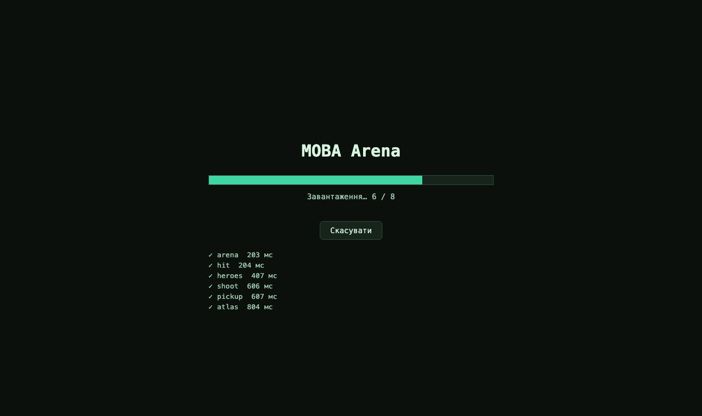
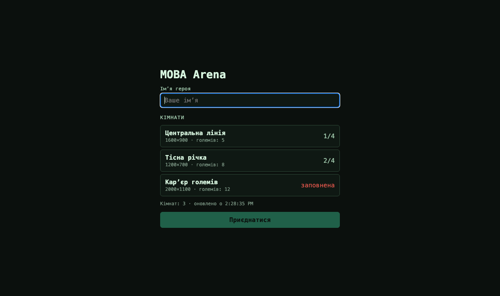
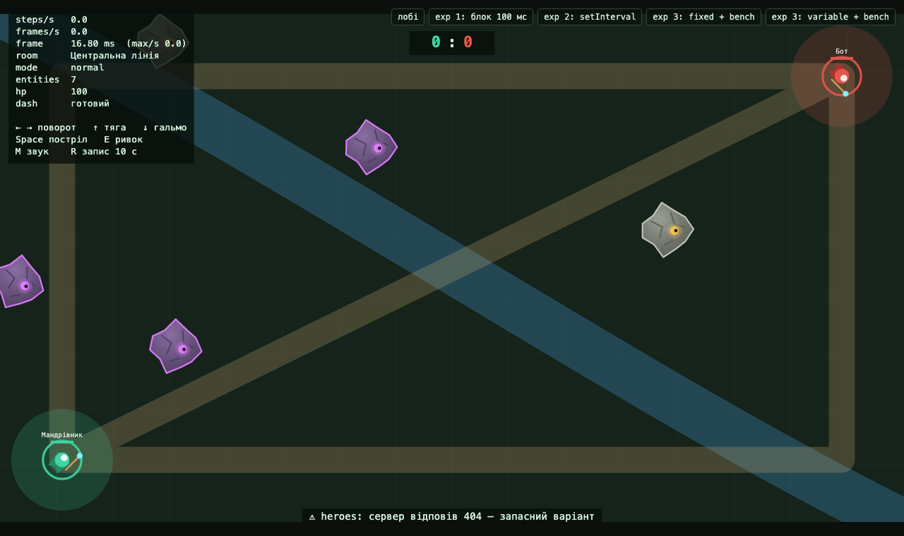
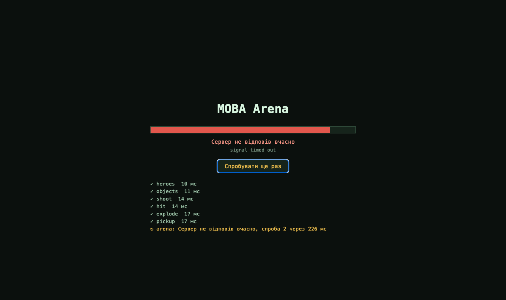
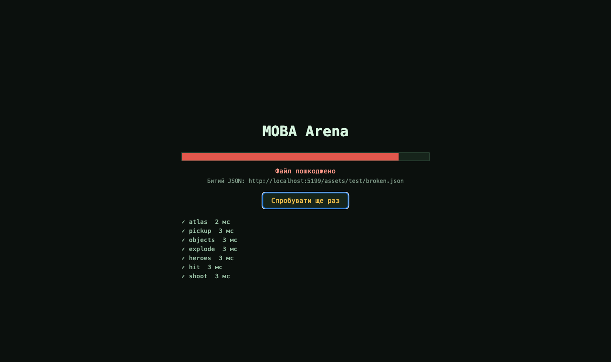
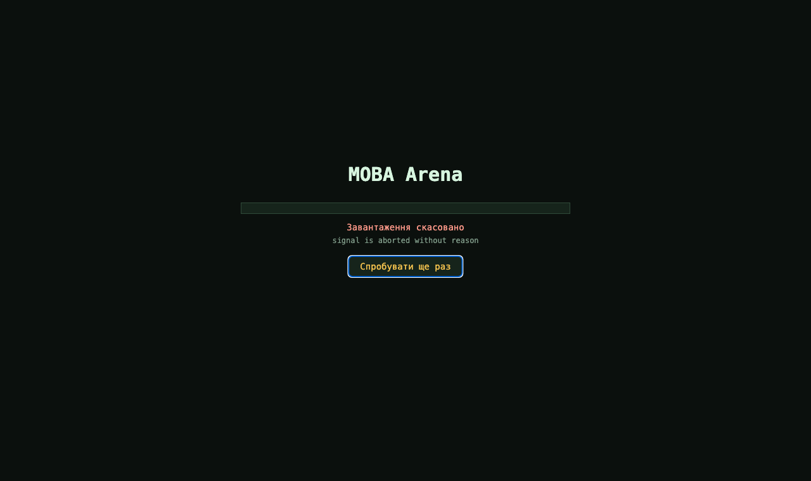

[← до сторінки проєкту](../../README.md)

# Lab 3 — асинхронний JavaScript

Шлях гравця: **завантаження → лобі → гра**. У `main.js` це три `await` поспіль; потік при
цьому не блокується — між ними працюють і смужка прогресу, і кнопки.

| Завантаження                      | Лобі                          |
| --------------------------------- | ----------------------------- |
|  |  |

## Пайплайн ассетів

- `manifest.json` перелічує 8 файлів: конфіг арени, атлас, два спрайтшити, чотири звуки.
- `fetchJson` перевіряє `response.ok`: `fetch` відхиляє проміс лише коли відповіді немає
  взагалі, а 404 для нього — успішно отримана відповідь. Не-`ok` стає `HttpError` зі статусом.
- `loadJson` / `loadImage` (`createImageBitmap`) / `loadAudio` (`decodeAudioData`) приймають
  `AbortSignal`. Те, що прийшло, але не декодувалось, — `ParseError`.
- `withRetry(fn, { attempts, baseMs, signal })`: пауза `baseMs · 2ⁿ` з jitter у межах
  50–100 %. **Не повторює** 4xx (крім 408 і 429), скасування й битий файл; повторює 5xx,
  таймаут і обрив мережі. Скасування перериває і саму паузу.
- `loadAll` запускає все через `Promise.all`; `onProgress` викликається для кожного файла
  (`start` / `retry` / `loaded` / `failed`), смужка показує `завершено / усього`.
  На кожну спробу — свій `AbortSignal.timeout`, об'єднаний із сигналом гравця через
  `AbortSignal.any`.
- `Promise.all` відхиляється на першій помилці, але **решту запитів не зупиняє**. Тому
  `loadAll` має власний `AbortController`: упав обов'язковий файл — скасовано всі сусідні.
- Файли з `"optional": true` не валять завантаження: спрайт, що не прийшов, замінюється
  векторним малюванням з Lab 2, звук — тишею. Обов'язковий лише `arena.json`.

### Sequential проти concurrent

Та сама функція з `strategy: 'sequential'` (`for … await` по одному) проти `Promise.all`.
Заміри в headless Chromium на локальному dev-сервері, по три прогони; «повільна мережа» —
`?net=slow`, штучна затримка 200–1000 мс на файл (сума затримок 4400 мс, найбільша — 1000 мс).

| Мережа                 | `Promise.all`, мс  | Послідовні `await`, мс | Різниця |
| ---------------------- | ------------------ | ---------------------- | ------- |
| повільна (`?net=slow`) | 1012 · 1006 · 1010 | 4443 · 4452 · 4447     | ×4.4    |
| локальна, без затримок | 5 · 3 · 4          | 9 · 6 · 9              | ×2      |

Одночасне завантаження триває стільки, скільки **найповільніший** файл (≈1000 мс),
послідовне — стільки, скільки **всі разом** (≈4400 мс). Потік один, але чекає не він:
запити виконує браузер поза JavaScript, а `await` лише віддає керування event loop до
моменту, коли відповідь стане в чергу. Послідовний `await` у циклі змушує наступний запит
навіть не починатися, доки не завершився попередній. Відтворити:
`/?net=slow&bench` і `/?net=slow&load=sequential&bench`, рядок `[loader]` у консолі.

## Спрайти, звук і шина подій

- **Спрайти.** `atlas.json` описує кадри (`sheet, x, y, w, h, radius`); `sprites.draw`
  викликає `drawImage` з прямокутником-джерелом і масштабує кадр до радіуса сутності.
  Герої (з полум'ям тяги й без), големи, снаряди й руни — зі спрайтшитів; вибухи — частинки.
- **Звук.** `audio.js` володіє `AudioContext`. Буфери декодуються під час завантаження
  (у призупиненому контексті це дозволено), а `resume()` викликається з першого жесту —
  кліку «Приєднатися» або клавіші. Перевірено в браузері: після кліку стан `running`, за
  4.5 с бою зіграно 28 пострілів, 23 влучання, 8 вибухів.
- **Шина подій.** `World` має `events = new EventTarget()` і розсилає `CustomEvent`:
  `fired`, `hit`, `exploded`, `pickup`, `score`, `respawned`. `audio.js` і `hud.js`
  підписуються через `addEventListener(type, fn, { signal })`; один `abort()` знімає всіх.
  Симуляція не імпортує ні звук, ні HUD — це перевіряє тест.
- `dispatchEvent` **синхронний**: слухач виконується в тому ж кроці симуляції, на тому ж
  стеку (головоломка 4). Це не черга задач.

## Лобі

> У Lab 4 статичний `rooms.json` замінено справжнім сервером: `join()` тепер відкриває
> WebSocket і чекає `welcome`. Опис нижче — стан на тег `lab-03`.

- `class Lobby extends EventTarget` — лише стан і мережа: `refresh()`, `start()` / `stop()`,
  `join(roomId, name)`; події `loading`, `rooms`, `error`, `joined`. DOM малює окремий
  `lobby/view.js`, який слухає ці події й не робить жодного `fetch`.
- **Оновлення, поки лобі видиме.** `start()` запускає цикл `refresh → sleep(3 с) → …`.
  Наступний запит планується лише після завершення попереднього, тож повільний сервер не
  накопичує чергу, як це зробив би `setInterval`. Вкладку сховали (`visibilitychange`) —
  `stop()`, повернулись — `start()`.
- **Таймаут на кожен запит:** `AbortSignal.timeout(2500)`, об'єднаний із сигналом лобі.
- **Abort, щойно гравець пішов.** `join()` викликає `stop()` → `controller.abort()`: це
  скасовує і запит у польоті, і паузу між запитами. Скасування не вважається помилкою.
  У браузері після «Приєднатися» за 4.5 с — 0 запитів до `rooms.json`.
- «Приєднатися» запускає локальну гру з конфігом арени кімнати (розмір, кількість големів,
  seed) поверх типового `arena.json`. Заповнена кімната — зрозуміле повідомлення, не падіння.
- `main.js` чекає на вхід через `await once(lobby, 'joined')` — подія, перетворена на проміс.

## Головоломки: задача, мікрозадача, кадр

Код — у `src/puzzles.js`. Вивід знятий запуском: 1–4 у Node (`npm run puzzles -w client`) і в Chromium,
5 — у Chromium (`/puzzles.html`); там, де запускались обидва, порядок однаковий.

**1. `await` розрізає функцію навпіл**

```js
async function load() {
  log('load: початок');
  await null;
  log('load: після await');
}
log('старт');
load();
Promise.resolve().then(() => log('then'));
log('кінець');
```

`старт → load: початок → кінець → load: після await → then` — усе до першого `await`
виконується синхронно; хвіст функції стає мікрозадачею і потрапляє в чергу раніше за `then`,
бо `load()` викликано раніше.

**2. `setTimeout` усередині `.then` і `.then` усередині `setTimeout`**

```js
setTimeout(() => {
  log('таймер 1');
  Promise.resolve().then(() => log('мікро з таймера 1'));
});
Promise.resolve().then(() => {
  log('мікро 1');
  setTimeout(() => log('таймер з мікро 1'));
});
setTimeout(() => log('таймер 2'));
```

`мікро 1 → таймер 1 → мікро з таймера 1 → таймер 2 → таймер з мікро 1` — мікрозадачі
зливаються до першої задачі; таймер, створений у `.then`, стає в чергу задач останнім; після
кожної задачі черга мікрозадач зливається знову, ще до наступного таймера.

**3. `return` проміса з `.then` коштує два зайві тики**

```js
Promise.resolve()
  .then(() => {
    log('A1');
    return Promise.resolve();
  })
  .then(() => log('A2'));
Promise.resolve()
  .then(() => log('B1'))
  .then(() => log('B2'))
  .then(() => log('B3'))
  .then(() => log('B4'));
```

`A1 → B1 → B2 → B3 → A2 → B4` — коли `.then` повертає проміс, рушій спершу окремою
мікрозадачею викликає його `then`, і лише наступною виконує зовнішній проміс; ланцюжок B
за цей час устигає зробити три кроки.

**4. `dispatchEvent` синхронний**

```js
const bus = new EventTarget();
bus.addEventListener('fired', () => {
  log('слухач: fired');
  queueMicrotask(() => log('мікро зі слухача'));
});
setTimeout(() => log('таймер'));
log('перед dispatch');
bus.dispatchEvent(new Event('fired'));
log('після dispatch');
```

`перед dispatch → слухач: fired → після dispatch → мікро зі слухача → таймер` —
`dispatchEvent` нічого не ставить у чергу: слухачі виконуються одразу, на тому ж стеку.
Мікрозадача зі слухача чекає, поки стек спорожніє.

**5. `requestAnimationFrame`: два колбеки одного кадру**

```js
requestAnimationFrame(() => {
  log('rAF A');
  Promise.resolve().then(() => log('мікро з A'));
  setTimeout(() => log('таймер з A'));
  requestAnimationFrame(() => log('rAF C (наступний кадр)'));
});
requestAnimationFrame(() => log('rAF B'));
```

`rAF A → мікро з A → rAF B → таймер з A → rAF C (наступний кадр)` — мікрозадачі зливаються
після **кожного** колбека, тому «мікро з A» встигає перед `rAF B`. rAF, запитаний усередині
rAF, іде в наступний кадр, а таймер — звичайна задача й устигає раніше за нього.

## Галерея збоїв

Кожен збій вмикається параметром URL (лише через Vite: `npm run dev:client` — затримки й
503 робить middleware у `vite.config.js`). Збій підмішується в першу спробу; «Спробувати ще
раз» вантажить справжній маніфест. В усіх п'яти випадках у консолі немає жодного
неперехопленого винятку, і гравець доходить до лобі та гри.

**404 спрайта — `/?fail=404`.** Гра стартує; герої намальовані запасним вектором, решта —
спрайтами; на екрані попередження. 404 не повторюється.

```txt
[loader] ✗ heroes: HTTP 404 Not Found: …/assets/sprites/heroes-missing.png — запасний варіант
[loader] concurrent: 6 мс, файлів: 8, не завантажено: 1
```



**Тимчасовий збій сервера — `/?fail=flaky`.** Двічі 503, третя спроба вдала; паузи ростуть.

```txt
[loader] ↻ heroes: HTTP 503 Service Unavailable: …/heroes.png?failTimes=2 — спроба 2 через 213 мс
[loader] ↻ heroes: HTTP 503 Service Unavailable: …/heroes.png?failTimes=2 — спроба 3 через 492 мс
[loader] concurrent: 720 мс, файлів: 8, не завантажено: 0
```

**Таймаут мережі — `/?fail=timeout`.** Обов'язковий `arena.json` «висить»; таймаут 1.5 с на
спробу, одна повторна спроба, потім — кнопка. Сім інших файлів уже завантажені.

```txt
[loader] ↻ arena: signal timed out — спроба 2 через 226 мс
[loader] Сервер не відповів вчасно — signal timed out
[loader] concurrent: 6 мс, файлів: 8, не завантажено: 0      ← після «Спробувати ще раз»
```



**Битий JSON — `/?fail=json`.** `ParseError`, без повторів (вдруге прийде той самий файл).

```txt
[loader] Файл пошкоджено — Битий JSON: …/assets/test/broken.json
[loader] concurrent: 5 мс, файлів: 8, не завантажено: 0      ← після «Спробувати ще раз»
```



**Abort посеред завантаження — `/?fail=abort`** (або кнопка «Скасувати» під час
`/?net=slow`). Усі запити в польоті скасовано одним `controller.abort()`.

```txt
[loader] Завантаження скасовано — signal is aborted without reason
[loader] concurrent: 6 мс, файлів: 8, не завантажено: 0      ← після «Спробувати ще раз»
```


