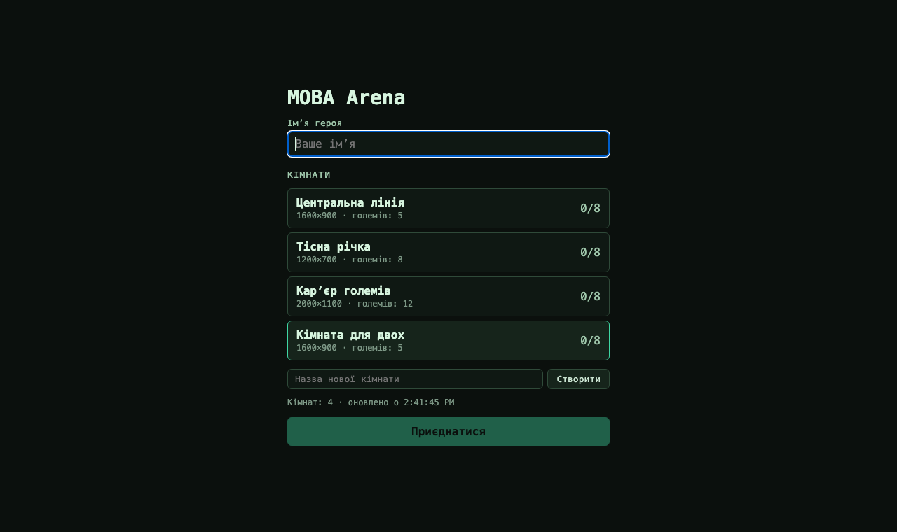
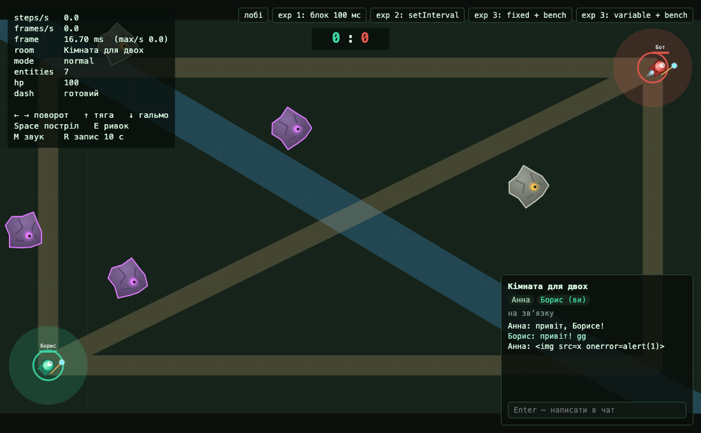
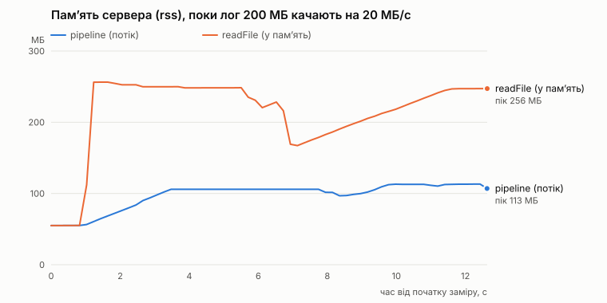

[← до сторінки проєкту](../../README.md)

# Lab 4 — Node.js: EventEmitter, streams, WebSocket-сервер

> Стан на тег `lab-04`: сервер тримав кімнати, вхід, вихід і чат, а кожне вікно грало свій
> локальний матч. З Lab 5 світ рахує сервер — див. вище.

| Лобі зі створеною кімнатою    | Друге вікно                         |
| ----------------------------- | ----------------------------------- |
|  |  |

## HTTP на `node:http`

- **Статика.** Сервер віддає `client/dist` потоком (`pipeline(createReadStream, response)`)
  з MIME-типом за розширенням. Шлях береться «сирим» із `request.url`: будь-який сегмент
  `..` — навіть закодований `%2e%2e` — це `400`, і окремо перевіряється, що шлях після
  `resolve()` лишився всередині каталогу.
- **API.** `GET /api/rooms` — список; `POST /api/rooms` — створення (тіло читається шматками
  з лічильником байтів: понад ліміт — `413`, не JSON чи не та форма — `400`, забагато кімнат —
  `409`); `GET /health` — стан і `rss`; `GET /api/replays` і `GET /api/replays/:id` — логи.
- **Розробка.** Vite проксує `/api`, `/health` і `/ws` на сервер, тож у браузері все на
  одному origin, як і в продакшені.
- **Конфіг.** `config.js` читає `process.env` один раз на старті й перевіряє всі значення
  одразу: `PORT=abc` — це код завершення 1 і список проблем, а не падіння о третій ночі.
- **Штатна зупинка.** За `SIGINT`/`SIGTERM`: перестати приймати з'єднання → закрити сокети
  з кодом `1001` → дописати логи матчів → дочекатися закриття HTTP-сервера. Наприкінці
  `process.exitCode = 0` без `process.exit()`: якщо процес не завершився сам, десь лишився
  незакритий ресурс. Тест запускає справжній процес і перевіряє код `0` і цілий лог.

## Кімнати й WebSocket

- **`Room extends EventEmitter`** з `players: Map` і подіями `start`, `join`, `leave`, `chat`,
  `empty`, `event`. Розсилка в сокети й лог матчу — це слухачі; сама кімната про них не знає.
- **`RoomManager`** видаляє кімнату, щойно вийшов останній гравець, або за таймером, якщо
  в створену так ніхто й не зайшов. Три постійні кімнати не видаляються.
- **Протокол** (`protocol.js`, у Lab 4 — версія 0): `{ v, type, … }`. Від клієнта — `join`, `chat`, `leave`;
  від сервера — `welcome`, `roster`, `chat`. Перевіряється **кожне** повідомлення: версія,
  тип, типи й довжини полів, відсутність зайвих полів.

| Що не так                                  | Код закриття |
| ------------------------------------------ | ------------ |
| не JSON, не та форма, зайве поле, бінарне  | `4000`       |
| невідомий тип                              | `4001`       |
| `join` не надійшов за 5 с                  | `4002`       |
| забагато повідомлень за секунду            | `4003`       |
| кімнати немає або вона заповнена           | `4004`       |
| не та версія протоколу                     | `4005`       |
| повідомлення більше за `maxPayload` (4 КБ) | `1009`       |
| сервер зупиняється                         | `1001`       |

- **Heartbeat.** `ping` раз на 15 с; сокет, що пропустив два `pong` поспіль, отримує
  `terminate()`. TCP сам не помітить, що ноутбук закрили: події `close` не буде.
- **Ліміт повідомлень** — token bucket: відро на N жетонів наповнюється зі швидкістю N/с
  (типово 10); порожнє відро — закриття з `4003`.
- **Повільний клієнт.** Якщо `socket.bufferedAmount` перевищив поріг (64 КБ), некритичне
  (чат; у Lab 5 — знімки стану) цьому клієнту не шлемо; склад кімнати шлемо все одно.
  Буфер у 16 разів більший за поріг — розрив.
- **Слухач `"error"` на кожному сокеті** — чому це обов'язково, див. нижче.
- **Клієнт** (`net/connection.js`): підписка за типом повідомлення, черга `send`, поки сокет
  не відкрито, і перепідключення з паузою `500 мс · 2ⁿ` (до 8 с) із jitter. Після кожного
  відкриття першим іде `join`, тож після перезапуску сервера гравець сам повертається
  в кімнату, а написане без зв'язку доходить. Після відмови сервера (`4000`–`4006`) повторів
  немає. Це перевірено тестом, який зупиняє й піднімає справжній сервер.

Перевірено у двох вікнах браузера через проксі Vite: обидва бачать склад кімнати й чат,
вихід одного з'являється в іншого, а повідомлення `` показується
текстом (у DOM — нуль елементів `img`).

## Лог матчу — потоки

```js
const events = on(room, 'event', { close: ['empty', 'shutdown'] }); // події → async-ітератор
pipeline(Readable.from(events), ndjsonTransform(), createWriteStream(file));
```

- `ndjsonTransform()` — `Transform` з `writableObjectMode`: на вхід об'єкти, на вихід рядки
  JSON, по одному на рядок. Лог відкривається, коли в кімнату заходить перший гравець,
  і закривається, коли виходить останній (або сервер зупиняється) — тоді ітератор
  завершується, і `pipeline` штатно дописує файл.
- **Повтор** — `readEvents(file)`: асинхронний генератор над `createReadStream` з власним
  розрізанням на рядки. `GET /api/replays/:id` віддає файл через
  `pipeline(createReadStream(file), response)` — у пам'ять він не читається.

### Графік: rss під час повільного завантаження



Синтетичний лог 200 МБ качає скрипт-клієнт, який після кожного шматка ставить потік на
паузу, тримаючи швидкість 20 МБ/с (≈11 с на файл); `rss` сервера знімається раз на 200 мс
через `/health`. Кожен прогін — на свіжому процесі сервера. Дані: `docs/lab-04/rss.csv`,
відтворити: `npm run bench:rss -w server`.

| Віддача                              | rss до | пік    | приріст |
| ------------------------------------ | ------ | ------ | ------- |
| `pipeline` (потік)                   | 55 МБ  | 113 МБ | +58 МБ  |
| `readFile` → `response.end` (наївно) | 55 МБ  | 256 МБ | +201 МБ |

Наївний варіант одразу займає пам'яті на весь файл і тримає її до кінця завантаження. Потік
за перші секунди набирає близько 50 МБ і далі **не росте**: з 4-ї по 11-ту секунду через
сервер пройшло ще ~140 МБ, а `rss` змінився на 7 МБ. Початковий приріст — це шматки по
64 КБ, які вже віддані й чекають збирача сміття, плюс буфер сокета; від розміру файла він
не залежить. (Крива «пласка» не від нуля, а від цього рівня — чесно показую як є.)

> Замір зроблено не через DevTools, а Node-клієнтом з обмеженням швидкості: так його можна
> повторити однією командою.

## Цикл подій, backpressure і `"error"`

**Фази циклу подій Node (libuv).** Одне коло: **timers** (`setTimeout`, `setInterval`) →
pending callbacks → **poll** (тут Node чекає на ввід-вивід і виконує його колбеки: дані із
сокета, новий HTTP-запит) → **check** (`setImmediate`) → close callbacks. Між будь-якими
двома колбеками зливаються черги `process.nextTick` і потім мікрозадач (проміси).
JavaScript виконує один потік; файли читає пул потоків libuv, а мережу — сама ОС
(epoll/kqueue), і готові результати стають у чергу фази poll.

**Обробник на 300 мс займає цикл.** `GET /api/slow` — синхронний `while` на 300 мс. Поки він
на стеку, цикл не доходить до фази poll: сервер не читає сокети, не розсилає чат, не
відповідає на `/health` і не відправляє `ping`. Дослід (`npm run demo:block -w server`):
Анна шле повідомлення кожні 50 мс, Борис міряє затримку доставки.

| Стан сервера        | Повідомлень | Медіана, мс | Макс, мс |
| ------------------- | ----------- | ----------- | -------- |
| цикл вільний        | 80          | 1.0         | 3.2      |
| під час `/api/slow` | 18          | 158.2       | 299.8    |

Жодне з 98 повідомлень не загубилось — вони чекали в буфері сокета ОС і прийшли пачкою,
щойно обробник повернув керування. Для гри це означає: один повільний запит зупиняє **всі**
кімнати на сервері водночас. Ліки — не блокувати: важку роботу розбивати на шматки, виносити
у `worker_threads` або в окремий процес.

**Backpressure.** Це сигнал «я не встигаю» від споживача до джерела. `write()` повертає
`false`, коли внутрішній буфер потоку заповнений; чесне джерело після цього чекає події
`drain`. Якщо сигнал ігнорувати, усе, що не встиг забрати повільний отримувач, накопичується
в пам'яті сервера. У цій лабі він з'являється тричі:

1. **Віддача повтору.** Клієнт читає повільно → заповнюється буфер TCP → `response.write()`
   повертає `false` → `pipeline` ставить читання файла на паузу. Тому крива на графіку пласка.
2. **Запис логу матчу.** Той самий `pipeline`: якщо диск не встигає, `Transform` і джерело
   призупиняються. Генератор тестового логу в `rss-benchmark.js` робить це вручну:
   `if (!stream.write(line)) await once(stream, 'drain')`.
3. **WebSocket.** Тут `pipeline` немає, тому стежимо самі: `bufferedAmount` — це і є черга
   невідправленого. Повільному клієнту некритичне не шлемо, найповільнішого — від'єднуємо.

**Чому `"error"` без слухача валить процес.** Для `EventEmitter` подія `"error"` особлива:
якщо слухача немає, `emit` кидає помилку як виняток. А кидає він її з колбека циклу подій,
де ловити нікому, — і процес завершується. Один клієнт із обірваним з'єднанням кладе сервер
для всіх. Те саме з промісами: відхилення, яке ніхто не зловив, з Node 15 теж завершує
процес. Вивід `npm run demo:error -w server`:

```txt
=== crash → код завершення 1 ===
сервер працює, 100 гравців онлайн
node:events:505
    throw er; // Unhandled 'error' event
    ^
Error: read ECONNRESET
Emitted 'error' event at:

=== fixed → код завершення 0 ===
сервер працює, 100 гравців онлайн
сокет зламався, закриваємо лише його: read ECONNRESET
сервер працює далі, 99 гравців онлайн

=== rejection → код завершення 1 ===
сервер працює, 100 гравців онлайн
      throw new Error('файл логу зник');
            ^
Error: файл логу зник

=== rejection-fixed → код завершення 0 ===
сервер працює, 100 гравців онлайн
відповідаємо 500: файл логу зник
сервер працює далі
```

Фікс у коді сервера: `ws.on('error', …)` на **кожному** сокеті (`ws.js`), `server.once('error')`
під час `listen` (зайнятий порт — це подія, а не виняток), і єдиний `.catch` на вході кожного
HTTP-запиту (`createRequestHandler` в `api.js`), який перетворює будь-яку помилку на `500`.
