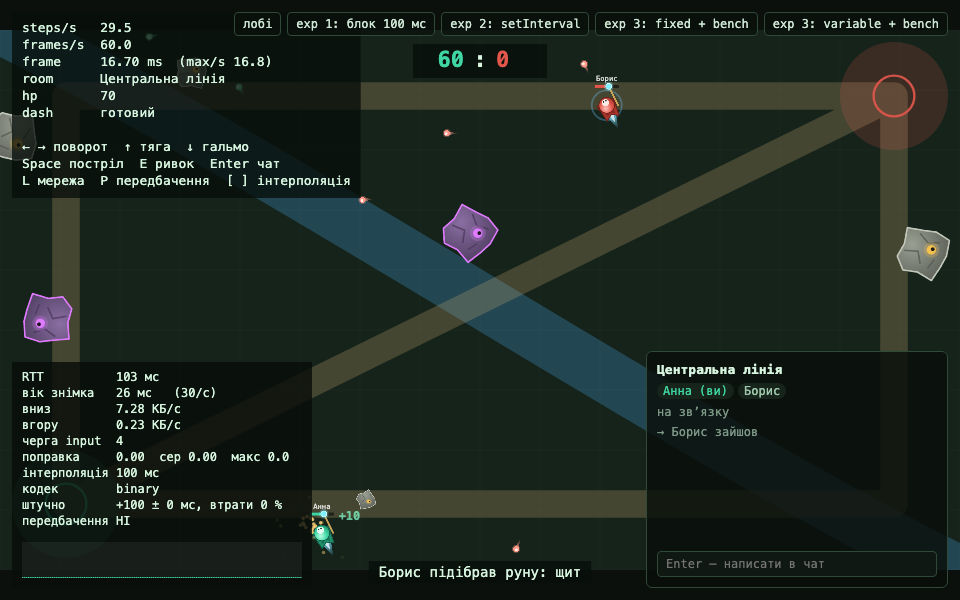
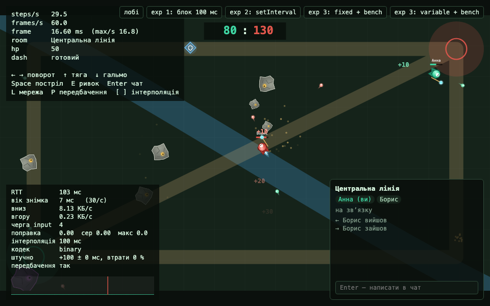
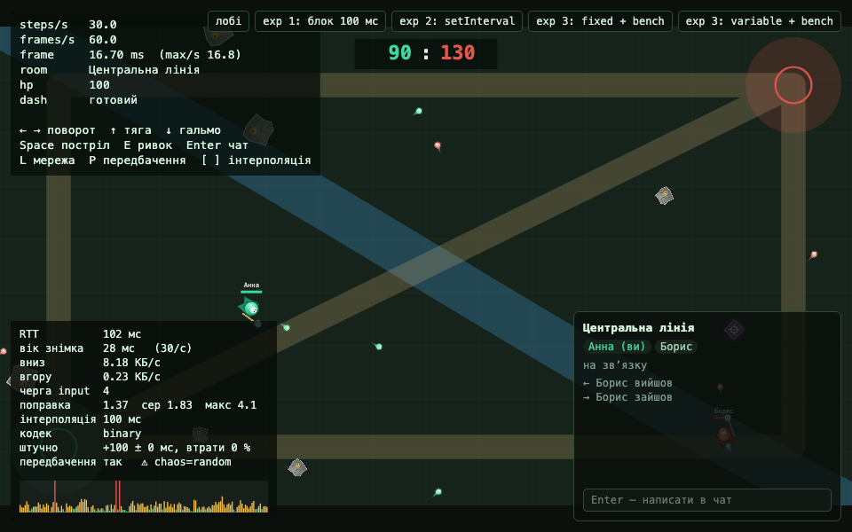

[← до сторінки проєкту](../../README.md)

# Lab 5 — сервер рахує гру

Клієнт надсилає **input** (газ, поворот, постріл), а не координати. Світ рахує лише сервер
і 30 разів на секунду розсилає знімки стану.

## Як це влаштовано

- **`shared/`.** Симуляція переїхала в окремий пакет: той самий код імпортують клієнт і
  сервер. Тести перевіряють, що пакет імпортує лише власні файли, не згадує `window`,
  `document`, `process` чи `Buffer` і цілком завантажується в Node.
- **Крок із фіксованим `dt = 1/30` с** — і на сервері, і в передбаченні на клієнті.
  Випадковість — лише із сіяного генератора, seed якого задає сервер; `Math.random()`,
  `Date.now()` і `performance.now()` у симуляції заборонені тестом.
- **Сервер** (`match.js`): `Match` на кімнату. Таймер не `setInterval`: кожен крок має
  абсолютний цільовий час `start + N · 33.3 мс`, і наступний `setTimeout` ставиться на
  залишок до нього — запізнення не накопичуються. За хвилину гри двох вікон: крок рахується
  в середньому 0.22 мс, запізнення старту кроку — у середньому 0.65 мс, найбільше 1.97 мс,
  пропущених кроків 0 (`GET /api/stats`).
- **Input.** У кожного є `seq`. Сервер складає їх у чергу гравця й за крок обробляє стільки,
  скільки прийшло; у знімку повертає `ack` — номер останнього обробленого. Герой рухається
  **лише від input**: немає input за цей крок — герой стоїть. Тому його позиція — функція
  отриманих команд, і клієнт може відтворити її точно.
- **Передбачення і звірка** (`net/prediction.js`). Клієнт одразу застосовує input тією самою
  функцією `stepInput` і пам'ятає його, доки сервер не підтвердить. На кожен знімок: викинути
  підтверджені input → стати у стан сервера → заново програти решту. Різниця з тим, що вже
  намальовано, — це «поправка»; вона згладжується експонентою (через 100 мс лишається ≈ 5 %).
- **Інтерполяція** (`net/interpolation.js`). Усіх, крім себе, клієнт малює на 100 мс у
  минулому — між двома знімками з буфера. Сутність, що зникла, домальовується до наступного
  знімка; нова з'являється, коли її знімок стає «лівим»; стрибок понад 300 одиниць (респаун)
  не розмазується. Якщо буфер спорожнів, тримається останній знімок — без екстраполяції.
- **Свої снаряди** з'являються одразу з передбаченого стану. Коли сервер підтверджує постріл,
  його снаряд прив'язується до локального за `id`; коли снаряд на сервері зникає (влучив або
  згас), зникає й локальний. Самонавідні снаряди не передбачаються.
- **Netgraph** (ліворуч унизу): RTT, вік останнього знімка, КБ/с вниз і вгору, черга
  непідтверджених input, величина поправки (остання, середня й найбільша за секунду) і графік
  поправок по знімках.

## Що показав netgraph: до і після передбачення

Два вікна Chromium, штучні +100 мс; обидва гравці 6–8 с летять, повертають і стріляють.

| Режим                          | RTT    | Черга input | Поправка: медіана | середня | найбільша |
| ------------------------------ | ------ | ----------- | ----------------- | ------- | --------- |
| без передбачення (`predict=0`) | 103 мс | 4           | —                 | —       | —         |
| з передбаченням                | 103 мс | 4           | 0.00              | 0.35    | 53.0      |
| `chaos=random`                 | 102 мс | 4           | 1.58              | 2.22    | 51.9      |
| 100 ± 30 мс, втрати 2 %        | 86 мс  | 4           | 0.00              | 3.34    | 414       |

- **Без передбачення** герой реагує на клавішу лише тоді, коли знімок із наслідком пройде
  весь шлях: RTT плюс затримка інтерполяції — понад 200 мс. Керувати можна, але герой
  «на гумці».
- **З передбаченням** герой реагує в тому ж кроці. Медіана поправки — нуль: у чистому полі
  клієнт і сервер рахують однаково. Сплески (до 53 одиниць) — зіткнення з големом чи іншим
  героєм: їх клієнт не передбачає, про відскок він дізнається зі знімка.
- **Погана мережа.** Медіана все одно нуль; середню псують втрачені input (сервер їх не
  бачив — клієнт уже застосував) і респаун: 414 — це телепорт після загибелі, він показується
  стрибком, без згладжування.

| Без передбачення                                       | З передбаченням                                  |
| ------------------------------------------------------ | ------------------------------------------------ |
|  |  |

## Дослід: зламати детермінізм навмисно

`?chaos=random` підмішує `Math.random()` у результат кожного кроку передбачення (у клієнті,
спільний код не чіпається). Поправка перестає бути нулем на **кожному** знімку: медіана
1.58 одиниці замість 0.00, і графік унизу netgraph заповнюється суцільно.

## Баг детермінізму, на який я справді натрапив

Сторінка `selftest.html` проганяє в браузері той самий еталонний матч (600 кроків), що й тест
у Node, і порівнює хеш стану світу. Перший запуск: **Node — `1d6cd7be`, Chromium —
`6d7512e4`**. Симуляція без `Math.random()` і без годинника давала різний результат у двох
рушіях.

Причина: `Math.sin`, `Math.cos`, `Math.atan2` (і `Math.exp`). Стандарт вимагає від них лише
«наближення», і Node з Chrome — різні версії V8 — розходяться в останньому біті. Я порівняв
результати 200 000 викликів кожної функції в обох рушіях: `sin`, `cos`, `atan2`, `exp` —
різні; `sqrt`, `%`, `**`, `Math.round`, `Math.imul`, `Math.hypot` — однакові. Один біт у куті
за кілька секунд стає іншим рішенням бота, іншим зіткненням і зовсім іншим матчем.

Фікс — `shared/src/sim/dmath.js`: власні `sin`, `cos`, `atan2`, зібрані лише з `+ − × ÷` і
`Math.sqrt`, які IEEE 754 визначає біт у біт. Точність проти `Math.*` — 3·10⁻¹³, для гри
з запасом. Після заміни хеш у Node і в Chromium однаковий — `4182399d`. Тест тепер
забороняє `Math.sin/cos/atan2/hypot/exp/random` у `shared/src/sim`.

(У грі цей баг майже не було видно: стан власного героя їде у знімку як `f32`, і різниця
в останньому біті `f64` губилася в округленні. Виявив його саме хеш.)

## Бінарний протокол

Формат описано в [`shared/PROTOCOL.md`](../../shared/PROTOCOL.md): little-endian, перший байт —
версія, кут — `Int16` (крок ≈ 0.0055°), позиції чужих сутностей — `Uint16` з кроком 1/16
одиниці, власний герой — `Float32`. `input` — рівно 8 байтів. JSON лишився за прапорцем
`?codec=json`. Round-trip тести: `decode(encode(msg))` дорівнює `msg` у межах квантування.

Матч із 4 гравцями, 30 знімків/с, хвилина гри, у середньому 22 сутності у знімку
(`npm run bench:codec -w server`, Node 26, Apple Silicon):

| Кодек               | Байтів/знімок | КБ/с на клієнта (вниз) | КБ/с на клієнта (вгору) | Encode+decode, мкс |
| ------------------- | ------------- | ---------------------- | ----------------------- | ------------------ |
| JSON                | 3163          | 92.66                  | 2.70                    | 9.2                |
| Binary (`DataView`) | 371           | 10.88                  | 0.23                    | 1.8                |

Бінарний знімок у 8.5 раза менший і кодується вп'ятеро швидше. У живій грі двох вікон
netgraph показав те саме співвідношення: 7.2 КБ/с проти 61.6 КБ/с вниз і 0.23 проти 2.67 КБ/с
вгору.

## Запис про мережу

**Затримка.** Між натисканням клавіші й відповіддю сервера минає RTT, і чесно прибрати його
неможливо. Тому клієнт не чекає: свого героя він рухає одразу (передбачення), а коли приходить
знімок — звіряє. Чужих героїв передбачити нема з чого, тож їх він показує на 100 мс пізніше,
зате плавно. Ціна: гравець бачить себе «зараз», а інших — «RTT/2 + 100 мс тому».

**Розбіжність стану.** Передбачення працює лише тому, що клієнт і сервер рахують однаково.
Три речі це тримають: спільний код у `shared/`, фіксований `dt` і герой, який рухається
тільки від input (а не від часу сервера). Розбіжності, що лишаються, — чесні: зіткнення,
яких клієнт не рахує, втрачений input, і знайдений вище баг із `Math.sin`. Кожну видно на
netgraph як сплеск поправки, і звірка сама повертає героя на місце.

**Чіти.** Сервер не приймає від клієнта нічого, крім кнопок: `turn` ∈ {−1, 0, 1} і чотири
біти. Написати «я в точці X» нема куди. Бюджет input — у середньому один на крок із запасом
шість, тож надіславши 300 input/с герой не полетить швидше (перевірено тестом: за 60 кроків
оброблено не більше 66). Номери `seq` мають зростати; кадр не тієї довжини чи з зайвими
бітами закриває сокет із кодом 4000. Чого сервер **не** ловить: бота, який цілиться сам, і
клієнта, що малює більше, ніж належить, — знімок містить усю арену.

**Затримка інтерполяції: 100 мс.** Знімки йдуть кожні 33 мс. Щоб інтерполювати, потрібен
знімок «після» моменту, який малюємо. 100 мс — це три інтервали: один знімок може загубитися,
ще один — запізнитись на 30 мс, і буфер усе одно не спорожніє. При 66 мс один втрачений
знімок уже дає завмирання; при 150–200 мс противника видно надто пізно, і влучити в нього
важче. Значення змінюється на льоту клавішами `[` і `]`, а netgraph пише «буфер порожній!»,
коли затримки не вистачило.

**Чого тут немає.** Компенсації затримки для пострілів: сервер перевіряє влучання за
поточним станом, а стрілець цілився в картинку 100+ мс давності, тож по рухомій цілі треба
брати упередження. І якщо input із пострілом загубився, локальний снаряд долітає «привидом»
без влучання — сервер такого пострілу не бачив.
