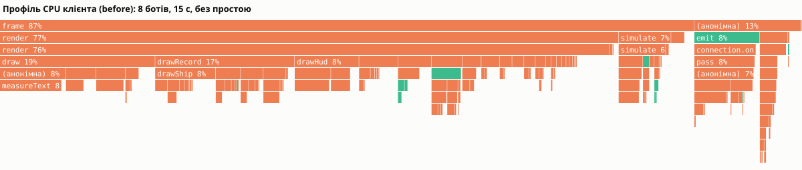
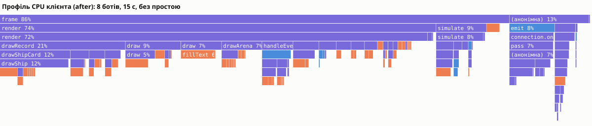
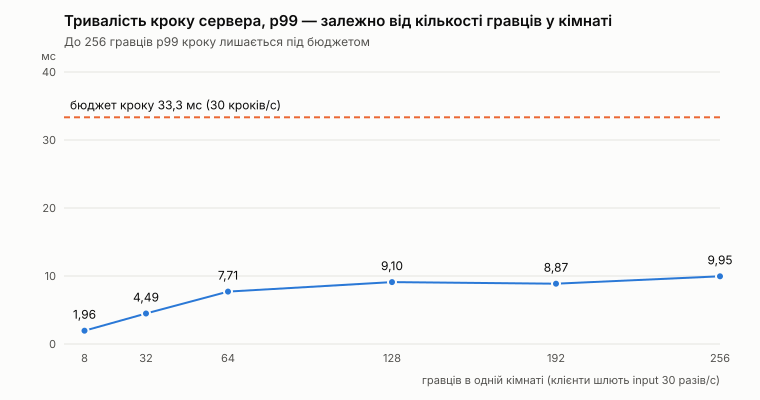

[← до сторінки проєкту](../../README.md)

# Lab 7 — V8, пам'ять і тести

## Тести

| Пакет    | Файлів | Тестів | Що всередині                                                           |
| -------- | ------ | ------ | ---------------------------------------------------------------------- |
| `shared` | 13     | 220    | вектор, `integrate`, колізії, детермінізм, кодеки, протокол, хеш-сітка |
| `client` | 5      | 63     | завантажувач, лобі, звірка з сервером, ігровий цикл, пули              |
| `server` | 9      | 53     | HTTP, сокети, матч, ліміт частоти, heartbeat, статистика               |
| e2e      | 2      | 3      | Playwright: два браузери в одній кімнаті                               |

- **Vitest** у трьох пакетах; `npm test` у корені запускає всі. Покриття `shared`:
  **98,95 % операторів, 99,34 % рядків, 95,88 % гілок** (поріг 85 % — нижче команда падає).
- **fast-check: 44 властивості**, серед них п'ять обов'язкових: (1) `decode(encode(msg))`
  дорівнює `msg` у межах округлення кута й позиції; (2) довжина кадру збігається з
  `PROTOCOL.md`, порахованою в тесті незалежно; (3) довільні, обрізані й «побиті» буфери дають
  значення або `CodecError` — нічого іншого; (4) герой за 1000 випадкових input лишається в
  арені зі скінченним станом і швидкістю не вище `MAX_SPEED`; (5) `parseClientMessage`
  приймає кожне згенероване правильне повідомлення й відхиляє кожну його мутацію.
- **Фейкові таймери:** ігровий цикл (рівно 60 кроків за секунду на 30, 60 і 144 Гц; після
  зависання на 5 с — 15–16 кроків, а не 300) і heartbeat сервера (два пропущені pong — розрив).
- **Playwright** піднімає справжній сервер, відкриває два контексти, обидва заходять в одну
  кімнату. Перевіряє: склад у обох; другий бачить рух першого **протягом 500 мс** після
  натискання (на практиці 231–233 мс, з яких ~200 мс — фізика розгону на 20 одиниць); чат в
  обидва боки; вихід одного видно іншому. 18 прогонів поспіль без збоїв.
- **CI** (GitHub Actions, на кожен push і PR): типи → lint → модульні тести → збірка → e2e.
- **Lint із перевіркою типів.** Увімкнено `no-floating-promises`, `no-misused-promises`,
  `await-thenable`. Знахідки: `async`-обробник кліку «Створити кімнату» (якби запит упав,
  помилка зникла б, а кнопка лишилась би вимкненою — тепер `try/finally` і `.catch`),
  три проміси в лобі, які ніхто не чекав, і обробники сигналів на сервері.

### Що знайшли нові тести

- **Снаряд проскакує крізь ціль.** Зіткнення перевіряються лише в кінці кроку. Стандартний
  снаряд (620 од/с, 20,7 од за крок) у нерухому ціль влучає завжди. Але на зустрічних курсах
  — снаряд із героя на повній швидкості (1140 од/с) проти героя, що летить назустріч, — пара
  зближується на 54,4 од за крок, а сума радіусів 21: снаряд перестрибує ціль. На 60 Гц той
  самий постріл влучає. Тест фіксує це як відому межу; виправлення (перевірка відрізка, а не
  точки) змінило б еталонний хеш і лишається на потім.
- **Руна діє на один крок довше:** 5 с — це 151 крок замість 150 (`left - dt <= 0` без
  запасу на похибку; у таймера респауну запас є).
- **`+π` після декодування стає `−π`** при повторному кодуванні — той самий кут, інші біти.
- **JSON губить знак нуля** (`-0` → `0`), бінарний кодек зберігає.
- **Zod рахує довжину імені в символах, а не в одиницях UTF-16:** ім'я з 16 емодзі проходить
  ліміт «16», хоча це 64 байти.
- **Позиція поза 0…4095** у бінарному знімку мовчки загортається в `u16`.

## Продуктивність клієнта: до і після

Запис: 30 с гри, 8 ботів (20–29 сутностей), тяга й постріл затиснуті. Headless Chromium 159,
Apple M3 Pro, збірка без мініфікації. Скрипт `client/scripts/perf-session.mjs` робить два
проходи: час кадру й паузи збирання сміття (трасування V8), потім профіль CPU й семплювання
купи. Сирі дані — `docs/lab-07/client-before.json` і `client-after.json`.

| Показник                               | До                                                       | Після                                                               |
| -------------------------------------- | -------------------------------------------------------- | ------------------------------------------------------------------- |
| час кадру p50 / p95 / p99 / макс, мс   | 16,7 / 16,7 / 16,8 / 16,8                                | 16,7 / 16,7 / 16,8 / 16,8                                           |
| `render` p50 / p95 / p99 / макс, мс    | 0,4 / 0,8 / 1,0 / 1,5                                    | 0,3 / 0,5 / 0,6 / 0,9                                               |
| `simulate` p99, мс                     | 0,3                                                      | 0,2                                                                 |
| `decode` / `reconcile` p99, мс         | 0,1 / 0,1                                                | 0,1 / 0,1                                                           |
| створюється об'єктів, КБ/с             | 1896                                                     | 775                                                                 |
| малі збирання сміття: кількість / макс | 13 / 1,7 мс                                              | 21 / 1,2 мс                                                         |
| великі збирання: кількість / макс      | 5 / 6,6 мс                                               | 3 / 9,8 мс                                                          |
| хто створює найбільше                  | `sample` 11,8 %, `render` 10,8 %, `blend` 9,9 %          | `draw` (canvas) 14,8 %, `decodeSnapshot` 12,0 %, `sampleInto` 7,6 % |
| найбільший власний час (без простою)   | `measureText` 0,3 %, `fillText` 0,2 %, `drawImage` 0,1 % | `fillText` 0,4 %, `drawShip` 0,2 %, `drawImage` 0,2 %               |

Полум'яні графіки з профілю CPU (ширина — частка часу разом із викликаним, простій відкинуто):

**Чесний висновок.** Гра і до змін не смикалась: кадр упирається у вертикальну синхронізацію
(16,7 мс), сама робота кадру займала близько 1 мс, а 85–87 % часу потік простоює. Жодного
кадру довшого за 16,8 мс не було ні до, ні після — тобто ціль «p99 < 16,7 мс» на цій
машині означає «не пропустити кадр», і вона виконується. Що реально змінилось: об'єктів
створюється у 2,4 раза менше, `render` став майже вдвічі коротшим у хвості, `measureText`
зник із лідерів.

**Нуля великих збирань не досягнуто: було 5, стало 3.** Усі три — «finalize incremental
marking»: завершення фонового маркування на купі 4–6 МБ, на 22-й, 25-й і 29-й секундах
(1–9,8 мс). Вони вміщаються в простій між кадрами й кадрів не зривають. Їх джерело — записи
знімків: вони живуть у буфері інтерполяції 0,4 с, частина встигає перейти в стару купу, і
її час від часу треба прибирати. Щоб дійти до нуля, декодер має писати знімки в готові
об'єкти з пулу замість створення нових — це наступний крок, і він зачепить спільний кодек.

### Що зроблено і чим обґрунтовано

| Зміна                                                                                     | Що показав профіль «до»                                      |
| ----------------------------------------------------------------------------------------- | ------------------------------------------------------------ |
| інтерполяція пише в готовий буфер (`sampleInto`), а не створює масив і об'єкт на сутність | `sample` + `blend` — 21,7 % усіх створених об'єктів          |
| «картки» для малювання — по одній на вид, а не нова на кожну сутність і кадр              | `render` — 10,8 %                                            |
| текст HUD і netgraph оновлюється 4 рази/с, ширина рядків кешується                        | `draw` панелей — 14,7 %; `measureText` — лідер власного часу |
| імена кадрів спрайтів із таблиць, а не `` `hero-${team}` `` щокадру                       | рядки в `drawShip` / `drawBullet`                            |
| частинки в типізованих масивах (пул на 2048 комірок)                                      | об'єкт на частинку, сплеск під час вибухів                   |
| власні снаряди з пулу (`createPool`)                                                      | об'єкт на постріл                                            |
| буфер знімків 12 замість 40                                                               | записи старіли до старої купи → великі збирання              |
| `fillStyle` міняється лише коли колір інший                                               | 150 розборів рядка кольору на кадр у графіку поправок        |

`performance.mark/measure` для `simulate`, `render`, `decode`, `reconcile` вмикаються
прапорцем `?perf=marks` (вони самі створюють об'єкти); без нього тривалості складаються в
кільцеві `Float32Array` без жодного нового об'єкта (`client/src/perf.ts`).

### Web Worker: не лишаємо

Кандидат — оновлення частинок. Дослід `client/worker-bench.html` (2048 частинок, 600 кадрів,
буфери передаються як transferable, без копіювання) міряє час **основного** потоку на кадр:

| Варіант                            | Основний потік, мкс/кадр (три прогони) |
| ---------------------------------- | -------------------------------------- |
| оновлювати самому                  | 13,2 · 9,0 · 8,5                       |
| надіслати воркеру й прийняти назад | 56,2 · 24,0 · 24,0                     |

Сама робота коштує ~9 мкс, а лише `postMessage` туди й обробник відповіді — 24 мкс: воркер
робить основний потік у 2,7 раза **повільнішим**. До того ж відповідь приходить на
наступному кадрі. Тому частинки лишились в основному потоці; файл воркера й сторінка досліду
збережені для повторення. Воркер виграв би там, де робота на порядки важча за пересилання.

## Сервер: профіль, просторовий хеш, навантаження

**Боти** (`server/src/bot.ts`, `Bot implements PlayerInput`): видають такий самий `Input`,
як клавіатура, і кладуть його в ту саму чергу гравця з наступним `seq` — матч не розрізняє
бота й людину. Переслідують, стріляють, а з малим здоров'ям тікають.
`POST /api/rooms/:id/bots { "count": 8 }` додає до 16.

**Профіль** (`node --cpu-prof`, хвилина матчу). З 16 ботами процесор зайнятий 5 % часу;
нагорі — обхід світу (`World` ітератор 7,6 %, `ofKind` 7,0 %) і `wrap` 6,2 %. Під справжнім
навантаженням (128 клієнтів) картина інша:

| Власний час, 128 клієнтів | Частка зайнятого CPU |
| ------------------------- | -------------------- |
| `writev` (сокети)         | 16,0 %               |
| `encodeSnapshot`          | 12,3 %               |
| `wrap`                    | 8,6 %                |
| `#broadcast`              | 6,5 %                |
| `quantizeAngle`           | 6,4 %                |
| `findCollisions`          | 2,7 %                |

Разом із викликаним розсилка знімків (`#broadcast`) — 49 % часу, крок світу — 16 %, з них
перевірка зіткнень усіх з усіма — 12 %.

**Просторовий хеш** (`shared/src/sim/spatial-hash.ts`). Видає ті самі пари в тому самому
порядку, що й наївний перебір, — інакше змінився б результат симуляції. Це перевіряють
fast-check на 500 випадкових світах і еталонний хеш матчу. Тонкість, яку знайшов тест:
наївний перебір перевіряє перетин «ліниво», вже після того, як попередні пари розштовхали
тіла, — тому й сітка мусить перевіряти ліниво й оновлювати комірки після кожної пари.

| Сутностей | Наївно, мкс | Хеш, мкс | Швидше |
| --------- | ----------- | -------- | ------ |
| 20        | 6,7         | 3,3      | 2,0×   |
| 100       | 173,5       | 17,4     | 9,9×   |
| 300       | 1613,6      | 69,9     | 23,1×  |
| 600       | 6887,0      | 181,0    | 38,1×  |

Крок матчу без мережі при 128 гравцях: 0,93 мс → 0,14 мс (у 6,4 раза). Сервер тепер
використовує хеш (`COLLISION=hash`, наївний лишився як `naive`). Але на повному кроці з
мережею різниця при 8, 64 і 128 клієнтах тоне в шумі замірів — бо головне там не зіткнення,
а розсилка.

**Навантажувальний тест** (`npm run load -w server`): N клієнтів без браузера в одній
кімнаті, кожен шле бінарний input 30 разів/с, 20 с після прогріву, свіжий сервер на кожне N.

| N   | Сутностей | Крок p50 / p99 / макс, мс | Завантаження циклу подій | RSS, МБ | КБ/с на клієнта |
| --- | --------- | ------------------------- | ------------------------ | ------- | --------------- |
| 8   | 40        | 0,92 / 1,96 / 3,01        | 0,06                     | 105     | 20,5            |
| 32  | 103       | 2,67 / 4,49 / 6,52        | 0,14                     | 111     | 54,7            |
| 64  | 167       | 5,04 / 7,71 / 13,94       | 0,21                     | 163     | 93,8            |
| 128 | 256       | 6,46 / 9,10 / 10,22       | 0,25                     | 155     | 153,0           |
| 192 | 321       | 7,64 / 8,87 / 10,99       | 0,29                     | 164     | 202,8           |
| 256 | 375       | 9,04 / 9,95 / 12,81       | 0,34                     | 169     | 248,5           |

**Межі в 33 мс не знайдено.** Навіть при 256 клієнтах в одній кімнаті (більше не дозволяє
конфіг) p99 кроку — 9,95 мс, третина бюджету; пропущених кроків і втрачених input немає.
Тобто за процесором місткість цього сервера — понад 256 гравців у кімнаті, і точне число
я не виміряв.

**Що впирається першим — не крок, а канал.** Кожному гравцеві сервер кодує власний знімок з
усіма сутностями, тож трафік на клієнта росте разом з N: 20 КБ/с при 8 гравцях, 153 КБ/с
при 128, 248 КБ/с (≈ 2 Мбіт/с) при 256 — а всього 63,6 МБ/с, що працює лише на loopback.
Це не збирання сміття (найдовша пауза 2,6 мс) і не зіткнення. Наступні кроки звідси:
кодувати спільну частину знімка один раз, слати лише сусідів і лише зміни.

Усі серверні заміри зроблено на Apple M3 Pro, поки машина була зайнята іншою роботою;
розкид між однаковими прогонами великий (p50 кроку при 128 клієнтах — від 3,9 до 7,0 мс).
